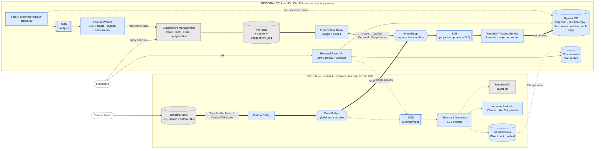
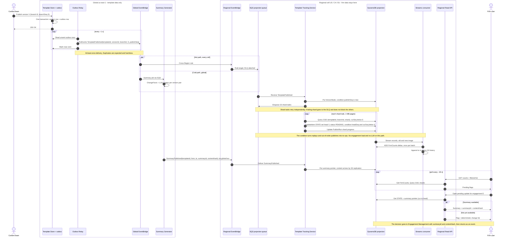
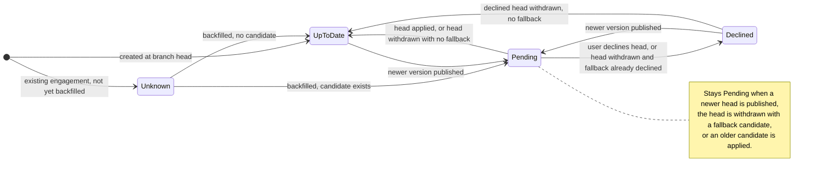
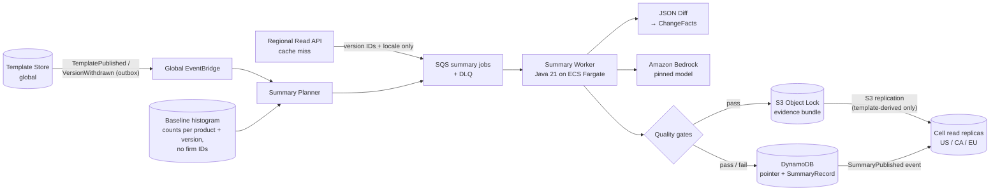

# Design Document

***[F]** = fact from the brief; **[A n%]** = my assumption and confidence. Targets are proposals.*

## 1. Architecture and data ownership

**Core decision.** Reading an engagement's template version costs a ~1 min load through another team's capacity-limited service [F], so no user-facing path may load engagements. Each region keeps a **projection** (engagement → template, branch, current version, declines, status) fed by events, and a publish sets the pending flag by writing to it. Loads happen only on a throttled cold path. Template events flow global → cell. The only cell → global traffic is tenant-free: summary requests carrying version IDs, and aggregate metrics (Figure 1).

**Figure 1 — Architecture and data ownership (thick = hot path, dotted = cold path, thin = user path; grey = existing, blue = new)**

[View diagram as PNG](img/image-01.png)

| Scope | Data and system of record | Owner |
|---|---|---|
| Global | Template versions, lineage, publish/withdraw events (Template Store) | Content platform (existing) |
| Global, replicated | Summaries and evidence bundles (S3 Object Lock) | Summary Generator (new) |
| Cell | Current version, apply/decline decisions (engagement file, firm DB) | Engagement Management (existing) |
| Cell | Projection: status, head, decision copy, firm counts (derived) | Template Tracking Service (new) |

**Hot path (Figure 2).** A publish commits the version row and an outbox row in one transaction. A relay sends the event through EventBridge to an SQS queue in each cell, where the Tracking Service (Lambda) queries a sharded index for engagements behind the new version and conditionally sets `status = PENDING`. No load and no LLM call is on this path. Users poll a regional read API every 30 s. The table is keyed by `engagementId` and the firm index is sharded, so the 40,000-engagement firm is never one partition. Decisions still go to Engagement Management, which loads the file [F] and validates the target, so a stale flag cannot cause a wrong decision.

**Figure 2 — Publish → flag sequence**

[View diagram as PNG](img/image-02.png)

## 2. Correctness and production evolution

**Version semantics [A 80%, confirm with content teams].** A branch is a market line, ordered by lineage position, never by version label; versions are cumulative along their lineage. `head(e)` is the newest non-withdrawn version ahead of `cur(e)` on its branch. Status is a pure function `f(graph, cur, declined)`, always recomputed, never toggled (Figure 3).

| Case | Behaviour |
|---|---|
| Updates accumulate | One open offer per engagement, `cur → head`; older offers are superseded and the summary is the single diff `cur → head`. |
| Decline | Pins **(engagement, target version)** only; `cur` does not move. v5 declined, then v7 published → PENDING (v7); its summary includes v5's changes. |
| Head withdrawn | Fall back to the next candidate: declined → DECLINED, none → UP_TO_DATE. Withdrawal never changes `cur` or deletes decisions or summaries. |

**Figure 3 — Engagement update status (derived)**

[View diagram as PNG](img/image-03.png)

- **Unreliable delivery** is at-least-once; exactly-once is not claimed. **Outbox at both sources of truth:** The Template Store and each firm DB write the event row, with a sequence number, in the same transaction as the change. The firm relay uses a post-commit nudge plus a 5-minute sweep instead of polling ~4,000 databases.
- **Idempotent, order-free sink.** Events carry state, not deltas, and every projection write is conditional on a source sequence, so duplicates and reordering are no-ops on SQS standard queues.
- **Reconciliation without loads:** version registry against the Template Store; nightly per-firm sequence digest, firm DB against projection; and a comparison whenever a user opens a file (the drift SLI). Only sampled reloads (0.5–5% a month) spend loader capacity.

**Migration and backfill (live, no maintenance window),** each phase behind a feature flag:

1. **Outbox first,** projection in shadow mode; then **seed** every engagement as UNKNOWN from an ID listing [A 70%: IDs can be listed without a load].
2. **Throttled backfill.** A load emits a snapshot event through the same outbox and sequence, so backfill cannot race live events; files users open index themselves for free. Just-published products go first, round-robin across firms. The UI is then enabled per firm: UNKNOWN shows as "verifying", never "up to date". Pre-cutover declines cannot be reconstructed [A], so those updates are offered again.

**Failure recovery.** The projection is disposable: point-in-time restore, then replay from the outboxes and the EventBridge archive; a full reload is the last resort. A loader outage only delays backfill. Poison messages go to an in-cell DLQ that alarms. Fan-out is tracked per publish and is resumable. A cell outage means stale flags with a "last updated" time, not failover; a reconciler then compares heads with the Template Store.

**Data residency.** One AWS account per cell with a policy denying other regions; cross-Region event schemas are checked in CI to carry no tenant field; logs, DLQs and backups stay in the cell. Third-party APM is the likeliest leak, so it is scrubbed. The LLM sees template content only.

## 3. Scale, cost and operational characteristics

Inputs [F]: 4,000 firms; 800,000 engagements (median 40 per firm, largest 40,000); 40 products; one publish per product per week = 40 × 52 ÷ 12 ≈ **173 publishes a month**. Other inputs are "Mid" assumptions.

| Quantity | Arithmetic | Result |
|---|---|---|
| Average publish | 800k ÷ 40 = 20k engagements × 2.5 write units × 60% in the US cell [A] | 30k units ≈ 8 s at DynamoDB's 4,000/s on-demand default |
| Peak burst: 3 publishes together, one a 10% product [A] | (80k + 2 × 18.5k) × 75% on-branch = 88k engagements × 2.5 × 60% | 132k units = 33 s at the default; pre-warm to ≥ 9k/s for 15 s (stress case, 338k engagements: ≥ 41k/s) |
| Backfill, one-time | 800k × 0.85 (indexed on open [A]) × 1.1 retries = 748k load-min = 12.5k slot-hours × \$0.1165 [A] | ≈ **\$1.5k**; US cell at 25 slots × 16 h/day [A] = **19 days** (76 days at 10 slots × 12 h) |
| LLM inference | 173 × 8 pairs [A] × (\$0.0049 generate + \$0.0038 judge) × 1.1 | ≈ **\$13 a month** (Claude Haiku 5.5, \$0.10 / \$0.50 per million tokens) |

**Monthly cost, Mid ≈ \$735:** polling \$311 (10k users [A] × 960 polls/day × 22 days × \$1.47 per million), firm outbox relay \$216 (priced as continuous polling; nudge-and-sweep should cut it ~70% [A]), observability \$100, worker \$54, reconciliation loads \$31, inference \$13, DynamoDB \$10. Range: **\$255** (5k users, 60 s poll) to **\$1,475** (20k users). `$X` is not given: the design fits a budget above ~\$1.5k a month; below that the levers are the poll interval and the relay, not inference. Not priced: NAT, data transfer, regional prices (confidence in the order of magnitude ~80%).

| Proposed SLO | Target | Measured by |
|---|---|---|
| Flag freshness, known engagements | Backend p95 ≤ 15 s, p99 ≤ 60 s; user-visible p95 ≤ 45 s (30 s poll) | Timestamps on each flag write |
| Completeness per publish and cell | 100% flagged within 5 min, for ≥ 99% of publishes | Expected vs. done counts |
| Integrity, drift, summaries | Missing publish detected ≤ 5 min; drift ≤ 0.1% of sampled loads; 99% of summaries within 15 min | Outbox vs. consumed IDs; reconciliation |

**Observability.** A `publishId` minted in the outbox correlates events, logs and progress rows. Completeness is proven by counts, because green infrastructure metrics can hide a missing publish. Pages: publish incomplete, missing event, DLQ depth, write throttling.

## 4. Generation and evaluation of the summaries

**Generation.** One summary per version pair and locale, never per engagement, so cost follows publishes, not the 800,000 engagements. A publish triggers the previous version and the most-used baselines; other pairs are generated on first request. Inputs are template content only, so generation is global and results replicate to the cells (Figure 4). The pipeline is: JSON diff → deterministic **ChangeFacts** (with rule-based severity) → the LLM rephrases those facts only, each sentence citing fact IDs → gates → publish. The ChangeFacts list is also the non-LLM fallback, always one click away.

**Figure 4 — Summary generation flow (cold path)**

[View diagram as PNG](img/image-04.png)

- **Evaluation, runtime gates (blocking):** every sentence cites valid facts; all high-severity facts are covered, because omission is the dangerous failure; numbers and identifiers match the cited facts. An LLM judge is advisory.
- **Evaluation, offline and online:** a golden set of past version pairs with content-team reference summaries gates every prompt or model change; content teams sample weekly. If generation fails, the UI shows the deterministic list and the decision records that variant.

**Defending in November what was shown in March.**

1. **What the user saw.** The in-region decision record stores engagement, versions, user, time, `summaryId`, content hash and variant.
2. **What it was built from.** The summary bundle is immutable (S3 Object Lock, 10 years [A]): diff, ChangeFacts, rendered prompt, raw response, final text, gate report, exact model ID and prompt version, under a signed SHA-256 manifest. Corrections, new models and withdrawals create superseding records; nothing is edited.
3. **No claim of reproducibility.** Models are retired and output is not bit-reproducible. The defence is "this is what was generated, from these inputs, by this model and prompt, and it passed these checks".

## 5. Tradeoffs, assumptions and the requirement I would challenge

| Decision | Rejected alternative | Price paid |
|---|---|---|
| Regional projection | Load on demand (largest firm: 40,000 load-minutes per page view) | A copy that can drift: outbox, backfill, reconciliation |
| Flag set at publish time | Compute at read time (one write per publish) | Write bursts on every publish and withdrawal; reads become key lookups |
| Polling | WebSocket push (~\$26 a month) | Poll interval is a latency floor; push can be added later |

**Assumptions to validate first:** every engagement write path, including copy and restore, emits an outbox event [50%]; 25 loader slots per cell [low]; ordered publish/withdraw events from the Template Store [70%].

**Requirement I would challenge: "real time — within seconds".** It merges latency with completeness. The backend meets seconds for engagements the projection knows, not for those awaiting backfill (days to weeks) or for summaries (minutes). A fast indicator that is silently incomplete is worse than an honest one. I would replace it with three commitments: flag latency for known engagements, a summary within 15 minutes, and completeness: UNKNOWN is never shown as up to date, and coverage is published.

**Riskiest part to get wrong: the status function over the version graph.** Its errors are silent, identical in every firm, and reconciliation would recompute the same wrong answer. Mitigations: one pure, versioned function; table-driven and property tests; sampled comparison against loaded engagements; fixes by replay. Tests prove my rules, not that they match content-team intent.

**Deliberately left out:** applying template content [F]; push and email notifications; bulk or automatic decisions; per-firm tailored summaries (confidential data in prompts); cross-region failover; human sign-off of summaries (affordable at ~40 publishes a week; a stakeholder decision).

