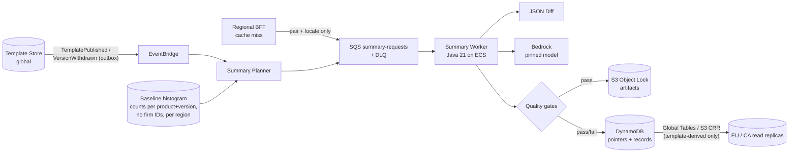

# 5. Summaries (LLM)

## 5.0 Basis

**Stated in the challenge:** template content is global and not firm-specific. A reliable JSON diff exists for any two versions of the same template. Users are non-technical. Versions branch, are withdrawn, and accumulate. A summary shown in March must be defensible in November. Inference counts toward the $X cap.

**Assumptions introduced (confidence):**

| ID | Assumption | Conf. |
|----|------------|-------|
| A1 | A summary describes the **applied baseline → offered target**, e.g. v3 → v7. A prior decline (for example of v5) is added as a deterministic note and is never generated by the LLM. | 80% |
| A2 | A decline records (engagement, target) and never moves the baseline. | 70% |
| A3 | Summaries are **template-only**. They contain no engagement data, so generation is global and residency-free. | 85% |
| A4 | Template content may be processed outside the EU/CA. Generation runs in one home region (assume `ca-central-1`). Flagged for contractual review. | 65% |
| A5 | No human pre-approval. Summaries auto-publish after automated gates, and content teams can override. | 50% |
| A6 | Each market has one locale, and the locale is part of the key. | 60% |
| A7 | Inference runs on Amazon Bedrock with a pinned model version and no data retention. | 80% |
| A8 | Retention is at least 7 years (typical audit-evidence horizon; confirm per jurisdiction). | 60% |

**Principles**
- The LLM is never on the hot path.
- A deterministic change list is always available.
- The LLM only rephrases facts that were computed deterministically.

---

## 5.1 Generation flow (cold path)

### Identity and cache keys

- **PairKey** is the logical lookup key: `productId | fromVersionId | toVersionId | locale`.
  - Version IDs are nodes in the version graph, not ordinals, so branches need no special case.
- **RecipeId** = `sha256(promptVersion | modelId | inferenceParams | validatorVersion)`.
- **InputsHash** = `sha256(PairKey | diffHash | factsHash | RecipeId)`. This is the idempotency key, so at most one published record exists per InputsHash.
- **Pointer** is one row per PairKey: `{currentSummaryId, status, leaseUntil, retryAfter}`. The hot path and UI read only the pointer.
- **SummaryRecord** is immutable and keyed by `summaryId` (UUIDv7). It holds every hash (see 5.2).

### Triggers: eager plus lazy

- **Eager**: on `TemplatePublished`, the Planner enqueues:
  - previous-on-branch → new;
  - plus the top-N baselines for that product from the histogram (counts only, so no residency concern). N=5 by default.
- **Lazy**: if the UI requests a pair with no pointer, the BFF enqueues `{PairKey}` and returns `PENDING`.
  - Meanwhile the UI shows the **deterministic change list**.
  - The `pending` badge itself is never blocked.

### Worker steps (per message)

1. **Claim (single-flight).** DynamoDB conditional write on the pointer, succeeding only if one of these holds:
   - `attribute_not_exists`, or
   - `status=GENERATING AND leaseUntil<now`, or
   - `status=FAILED AND retryAfter<now`.

   If the claim fails, a concurrent or duplicate request already owns it, so ack and drop.
2. Load both versions, then compute a **canonical JSON diff** (sorted keys, normalized whitespace) and `diffHash`.
3. **ChangeFacts** (deterministic): turn the diff into a list of facts `{factId, section, kind: ADDED|REMOVED|MODIFIED, entity, before, after, severity}`.
   - `severity` is rule-based. Examples of high severity: a procedure is removed, a standard reference changes, an opinion template changes.
   - This list doubles as the **non-LLM fallback** rendering.
4. **Prompt.** The prompt receives facts only, never the raw archive, and runs at temperature 0. Output is structured JSON: `[{text, factIds[]}]`.
   - Large diffs are chunked by section and merged deterministically.
5. **Quality gates** (5.2). On pass, write the artifact bundle to S3 (Object Lock), insert the SummaryRecord, swing the pointer, and emit `SummaryPublished`.
6. **Retries.** Bedrock throttling or 5xx errors get exponential backoff with jitter, max 3 attempts, and a bounded worker concurrency (protects Bedrock quota and the $ cap).
   - A gate failure gets 1 regeneration with the same recipe. If it fails again, the pointer becomes `FAILED`, the message goes to the DLQ, and an alert fires.
   - The UI stays on the deterministic list.

### Invalidation rules (nothing is ever mutated or deleted)

| Event | Action |
|-------|--------|
| Template version content | Immutable after publish, so no content-based invalidation. A changed `diffHash` would yield a new record. |
| New prompt/model (new RecipeId) | Regenerate **only pairs with pending engagements > 0**. The new record supersedes; the old one is retained. |
| Correction by content team | New record with `supersedes` and `reason`. The pointer moves; the old record is retained. |
| `VersionWithdrawn` | Pointers involving that version become `WITHDRAWN` and are no longer offered. Records are retained, since they may have been shown. |
| Supersession (v7 after declined v5) | A new pair (baseline → v7) is generated. The v5 summary stays as evidence for the earlier decline. |

### Residency

- Generation sees only template content plus pair identifiers. **No firm, engagement, or user IDs leave a region.**
- Lazy requests carry the PairKey only.
- Summaries are replicated read-only to EU/CA stores, so regional UIs read locally.
- Who saw which summary is recorded **in the regional decision store** (5.2).
- Bedrock cross-region inference profiles may route requests outside the home region. That is acceptable for template-only content under A4, but needs confirmation (confidence 60%).

### Cost shape

Cost scales with **publishes × distinct baselines**, not with the 800k engagements.

- 40 products × ~4.3 publishes/month ≈ 175 publishes/month.
- Each publish generates ~6 pairs × 1–2 locales ≈ 1–2k generations/month, plus the lazy tail.
- At ~20k input and ~1.5k output tokens, plus one judge call, the cost is roughly $0.10–0.25 per summary, so **≈ $150–500/month**.
- Uncertain (55%): depends on the model tier and current Bedrock pricing. Feeds into 4.1.

---

## 5.2 Evaluation and audit defensibility

**Immutability and history**
- Each summary is stored as an artifact bundle in S3 with **Object Lock (compliance mode)**, retained ≥ 7 years (A8). The bundle contains:
  - the canonical diff;
  - the ChangeFacts;
  - the rendered prompt;
  - the raw model response;
  - the validated output;
  - the gate report.
- SummaryRecords are append-only. Corrections and withdrawals add records or pointer states and never edit existing records.
- Pointer transitions are logged as events in an append-only audit stream.

**Cryptographic hashes**
- SHA-256 is computed over:
  - both template archives (canonicalized);
  - the diff;
  - the facts;
  - the rendered prompt;
  - the raw response;
  - the final output.
- All hashes go into a manifest. The manifest hash is **signed with a KMS asymmetric key**, which gives tamper evidence independent of storage permissions.

**Model identification**
- The record stores:
  - the exact Bedrock model ID with its version (never an alias or "latest");
  - the region;
  - the inference parameters;
  - the Bedrock request ID.
- Model deprecation does not affect old evidence. It only triggers regeneration under a new RecipeId.

**Prompt versioning**
- Prompts are code: stored in git, semver-tagged, and content-hashed.
- The record stores `promptVersion`, `promptHash`, and the **full rendered prompt**, not just a template reference.

**Reproducibility limits (state these openly)**
- LLM output is not bit-reproducible, even at temperature 0, and providers retire models.
- The defense is therefore **"we can show exactly what was generated, from what, and how"**, based on the archived inputs and outputs. It does not rely on regenerating the summary.
- Re-runs are used for evaluation only, never as evidence.

**Hallucination prevention and factual accuracy**
- The model only rephrases ChangeFacts. It does not interpret standards, give advice, or assess impact.
- Every output bullet must cite ≥ 1 valid `factId`. A bullet with no citation is rejected.
- **Coverage**: every high-severity fact must be cited by at least one bullet. Omission is the most dangerous failure in audit, more dangerous than awkward phrasing.
- **Entity check**: identifiers, numbers, and standard references in the text must appear in the cited facts.
- The UI label reads *"AI-generated summary — see detailed changes"* and links to the deterministic list. This supports the user's judgment rather than replacing it.

**Evaluation and quality gates**
- **Runtime gates, in order**:
  1. schema valid;
  2. citation validity;
  3. critical-fact coverage = 100%;
  4. entity/number check;
  5. length and readability bounds;
  6. LLM-as-judge faithfulness score (advisory, never the sole gate).
- **Offline gate before any prompt or model change**:
  - Build a golden set of historical version pairs with reference summaries written by content teams.
  - A change is blocked if it regresses coverage, unsupported-claim rate, or readability.
- **Online monitoring**:
  - a per-summary "unclear / incorrect" user flag;
  - weekly sampled review by the content team;
  - tracking of gate-failure rate and fallback rate as SLIs.

**Traceability**
- The SummaryRecord (global) holds:
  - `templateId`;
  - `from/toVersionId` and their archive hashes;
  - `diffHash` and `factsHash`;
  - `modelId` and `promptVersion`/`promptHash`;
  - `validatorVersion`;
  - `manifestSignature`, `createdAt`, and `supersedes`.
- The decision record (**regional**, in the engagement store) holds:
  - `engagementId`, `user`, and `decision`;
  - `summaryId` and `outputHash`;
  - `variant` (LLM or deterministic) and timestamp.
- Together these answer *"what exactly did this user see before declining in March?"* without moving engagement data out of its region.

**Failure handling**
- The hot path is unaffected: the pending indicator never waits on a summary.
- If the summary is missing, `FAILED`, or blocked by a gate, the UI shows the **deterministic change list**, labeled as such.
- Apply/decline remains allowed, and the decision records `variant=DETERMINISTIC`. Assumption: blocking decisions on LLM availability is unacceptable (75%).
- DLQ depth and `FAILED` pointers trigger alerts.
- A content team can publish a human-written override as a superseding record.

**Riskiest part of this section:** a fluent summary that **omits** a material change. This is mitigated by deterministic ChangeFacts, mandatory critical-fact coverage, and the always-available detailed list.
