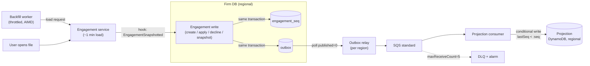

## 3.1 Migration, Backfill & Reliable Delivery

> Scope: WBS 3.1 + 3.2 combined (migration/backfill + outbox, idempotency, reconciliation).

### Facts and assumptions

| ID | Type | Statement | Design impact |
|----|------|-----------|---------------|
| F1 | Fact | No domain events exist today. An outbox table can be added to each firm DB. CDC is out of scope. | Transactional outbox plus a polling relay. |
| F2 | Fact | Engagement IDs (with firm, product, region) can be enumerated without loading files. | Every engagement is seeded as `UNKNOWN` on day one, so there are no false negatives. |
| F3 | Fact | Engagement files have no monotonic revision. | We add our own per-engagement sequence. |
| F4 | Fact | Pre-cutover apply/decline history cannot be reconstructed. | Conservative re-prompt (see Guarantees). |
| F5 | Fact | Eventual consistency and a tri-state UI (`PENDING` / `UP_TO_DATE` / `UNKNOWN`) are acceptable during migration. | Launch does not wait for backfill to finish. |
| A1 | Assumption | Loader capacity is 25 concurrent loads per region, across 3 regions (US, EU, CA). Confidence: **Low**; to be validated with the owning team. | Sets backfill duration; throttle limits are configuration, not code. |
| A2 | Assumption | All engagement writes (create, apply, decline) go through the Engagement service. Confidence: **Medium**. | Write paths outside the service are the top correctness risk. |

### Event flow (backfill is just another event)

### Migration phases (zero downtime; each phase can be switched off by feature flag)

- **Phase 0 — Outbox first.**
  - The Engagement service writes an outbox row in the same transaction as each create, apply, and decline. The Template store does the same for publish and withdraw.
  - The projection runs in shadow mode, with no UI.
  - *Why:* events flow before state is seeded, so nothing that happens after cutover is missed.
- **Phase 1 — Seed.**
  - Enumerate all engagements (F2) and insert them as `UNKNOWN`, using `attribute_not_exists(pk)` so a seed never overwrites a live event.
  - *Why:* no false negatives. Unindexed engagements show "verifying", never "up to date".
- **Phase 2 — Throttled backfill** (see below).
- **Phase 3 — Enable the UI per firm and region.**
  - "Up to date" is only shown for indexed rows. The tri-state UI ships before backfill completes (F5).

### Ordering without a native revision

- **Per-engagement sequence.** A `engagement_seq` row is incremented in the same transaction as the outbox insert. Its row lock gives a strict per-engagement order at the source.
  - An outbox `IDENTITY` column is **not** used for ordering. Concurrent transactions can commit out of id order, so a relay polling `id > lastId` would skip late commits.
- **Relay polls `published = 0`**, not a high-water id, for the same reason.

### Backfill

- **Backfill is just another event (key decision).**
  - The worker asks the Engagement service to load the file. A hook emits `EngagementSnapshotted` (template version and lineage) through the same outbox and sequence.
  - *Why:* there is one write path and one ordering. A stale snapshot has a lower `seq` and is rejected at the sink, so the backfill-vs-live race is removed by construction rather than managed.
- **Piggyback indexing.**
  - Files opened during normal work are already rehydrated, so the same hook emits a snapshot at zero extra load cost.
  - Active engagements index themselves first. The size of this effect is unknown (confidence: Low).
- **Throttling.**
  - The per-region worker pool has adaptive concurrency (AIMD) driven by loader latency and error rate.
  - A circuit breaker and a manual pause switch are included.
  - Capacity is weighted toward off-peak hours, so interactive users are never starved.
- **Fairness and priority.**
  - Work is scheduled round-robin across firms. The median firm (~40 files) is indexed in about 2 h, and the 40k-file firm absorbs spare capacity.
  - Engagements on a just-published product jump the queue.
- **Duration (A1).**
  - Total work is 800,000 load-minutes.
  - At 75 slots: 800,000 ÷ 75 ≈ 10,700 min, about **7.5 days**.
  - If one region holds most files (25 slots): about **22 days**.
  - Piggyback indexing shortens both.
- **Resumable by construction.**
  - Progress lives in the projection row itself (`UNKNOWN` → `INDEXED` | `LOAD_FAILED`), so a restart simply re-scans `UNKNOWN` rows.
  - Coverage % is published per firm and region as a CloudWatch metric.
  - Failed loads are retried 3× with backoff, then marked `LOAD_FAILED` and shown on the dashboard.

### Delivery guarantees and idempotency

- **At-least-once end to end; exactly-once is not claimed.**
  - The relay can crash after publishing and before marking the row, so duplicates are expected by design.
- **Order is enforced at the sink, not the pipe.**
  - Messages go through standard SQS (not FIFO) to a DynamoDB conditional update: `attribute_not_exists(lastSeq) OR lastSeq < :seq`.
  - `ConditionalCheckFailed` is treated as success, since it means a duplicate or stale event.
  - *Why:* once the sink is idempotent, FIFO's throughput limits and head-of-line blocking buy nothing.
- **Template events** use the idempotency key `(templateId, versionId, eventType)`. Fan-out job IDs are deterministic, so a replayed publish creates no duplicate work.
- **"Pending" is derived, not toggled.** It is recomputed from current version, decline pin, and published lineage. Applying events in a different order therefore converges to the same result.

### Failure handling

- **Consumer failures:** retried through the SQS visibility timeout.
  - After `maxReceiveCount = 5`, the message moves to the DLQ.
  - Consumers report partial batch failures (`ReportBatchItemFailures`).
- **Poison messages:** any DLQ depth > 0 raises an alarm.
  - The affected engagement is marked `STALE`, so the UI shows "verifying".
  - Messages are redriven after the fix.
  - DLQ retention is set longer than source-queue retention.
- **Outbox hygiene:** published rows are purged after 7 days. An alarm fires on the age of the oldest unpublished row, so a stuck relay shows up as lag.

### Reconciliation and repair (cheapest first; never a full reload)

1. **Row count — daily, zero loads.** Compare enumerated IDs with projection rows per firm. This catches missing seeds.
2. **Sequence check — daily, zero loads.** Compare `max(seq)` in the firm DB with `lastSeq` in the projection. This catches lost or stuck events. Repair by replaying the outbox from that `seq`.
3. **Open-time check — continuous, free.** On every session open, compare the in-memory version with the projection.
   - The mismatch rate is the **drift SLI**.
   - A mismatch self-repairs through the snapshot event.
   - This catches writes that bypass the outbox (A2).
4. **Sampled reload — weekly.** Reload about 0.1% of files (~800 loads) as a statistical audit.
   - Any non-zero drift triggers targeted re-snapshots, not a rebuild.

### Guarantees (and non-guarantees)

| Layer | Guarantee |
|-------|-----------|
| **Source-of-truth correctness** | The engagement file is authoritative. Apply/decline already loads the file and re-validates, so a stale projection can never cause a wrong decision. |
| **Projection convergence** | Eventual. Measured by checks 1–3 above. Holds only if A2 holds. |
| **Notification latency** | Seconds, for indexed engagements only. `UNKNOWN` rows wait for backfill. |
| **Not guaranteed** | Exactly-once delivery; global ordering; pre-cutover declines (F4). These are re-shown as *"previously reviewed: unknown"*, a deliberate false positive over a false negative. |

### Key risks

| Risk | Severity | Mitigation |
|------|----------|------------|
| Write paths that bypass the outbox (DB restores, admin tools, bulk imports) | **High** | Inventory all write paths. Any DB restore triggers a firm-wide re-snapshot. The drift SLI alarms on mismatch. |
| Loader capacity is unknown (A1); backfill could take weeks | Medium | The tri-state UI keeps the indicator honest. Piggyback and publish-priority indexing shrink user-visible impact. |
| Relay throughput across thousands of firm DBs | Medium | One relay per region with sharded polling over the firm list, polling every 1–2 s. Needs a load test (confidence: Medium). |

### References

- [Transactional outbox pattern — AWS Prescriptive Guidance](https://docs.aws.amazon.com/prescriptive-guidance/latest/cloud-design-patterns/transactional-outbox.html)
- [DynamoDB condition expressions](https://docs.aws.amazon.com/amazondynamodb/latest/developerguide/Expressions.ConditionExpressions.html)
- [Amazon SQS dead-letter queues](https://docs.aws.amazon.com/AWSSimpleQueueService/latest/SQSDeveloperGuide/sqs-dead-letter-queues.html)
- [Amazon SQS visibility timeout](https://docs.aws.amazon.com/AWSSimpleQueueService/latest/SQSDeveloperGuide/sqs-visibility-timeout.html)
- [Lambda: handling errors for an SQS event source (partial batch responses)](https://docs.aws.amazon.com/lambda/latest/dg/services-sqs-errorhandling.html)

### Hand-off to later steps

- **3.3** — Region-scoped relay, queues, and projection: confirm that no engagement data crosses regions. Only template events fan out from global to regional.
- **4.1** — Relay polling cost and backfill worker cost, based on A1.
- **4.2** — SLOs: projection lag p99, drift rate, backfill coverage %, DLQ depth.
- **7** — The Part 2 fan-out worker reuses the throttling contract defined here (AIMD, fairness, idempotent job IDs).
