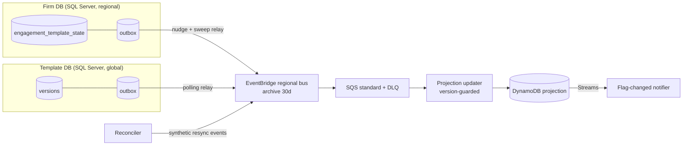

# WBS 3.2 — Unreliable Delivery: Idempotency, Outbox, Reconciliation

**Session close-out** · Parent: 3. Correctness & Evolution · Budget: 0:15 · Status: **Done**

---

## A. Clarifications (session record)

| # | Question | Answer | Status |
|---|---|---|---|
| 1 | Producer storage | All SQL Server (Template DB and firm DBs) | Confirmed |
| 2 | Event contract: `eventId`, `aggregateVersion`, lineage | Yes, we define and own it | Confirmed |
| 3 | Decision source of truth | Firm DB; projection is derived | Confirmed |
| 4 | Cheap reconciliation source | Firm catalog exposes engagement IDs + `lastModified`; template version only via load | Assumed (default) |
| 5 | Consistency targets | Flag p99 < 60 s after publish commit; drift repaired < 24 h; prefer false "pending" | Assumed (default) |
| 6 | Bus and replay | EventBridge regional bus with archive; **retention value not given, assumed 30 days** | Partly confirmed |
| 7 | Load service idempotency | None; dedupe on our side with a DynamoDB work ledger | Assumed (default) |

---

## B. Design section (paste into design doc)

### 1. Reliability strategy

- **Model:** at-least-once delivery everywhere, with idempotent, version-guarded consumers. This gives an *effectively-once state effect*. We do not claim exactly-once delivery.
- **Hard guarantees:**
  - No committed source change is permanently lost. This rests on three layers: outbox, then replay, then reconciliation.
  - Each projection row only moves forward per engagement. It never regresses.
- **Best-effort:**
  - Latency (the seconds-level target).
  - Cross-aggregate ordering.
  - Freshness during relay or bus outages.
- **Design rule:** the projection is derived and disposable. It has exactly one write path, the version-guarded updater. Reconcilers and replays feed into that same path; they never write the projection directly.

### 2. Idempotency and ordering

**Idempotency and ordering are separate problems.** Idempotency makes duplicates harmless. Version guards make reordering harmless. Neither one creates order, and the design does not need order.

**Events carry state, not deltas.** Each engagement event holds the full projection-relevant state:
- `templateId`, `branch`, `baseVersion`
- `decision`, `decidedVersion`
- `aggregateVersion`

Because of this, a missing intermediate event is superseded by the next one. Gaps are tolerated, not fatal.

**Projection write rule** (DynamoDB conditional update):
- Condition: `attribute_not_exists(aggVersion) OR aggVersion < :v`.
- If the condition fails, the event is a duplicate or stale. The consumer acks, drops it, and emits a `stale_or_dup` metric.

**Template events:**
- Keyed by `(productId, branch, versionId)`. Versions are immutable.
- The version registry applies a lifecycle precedence where `WITHDRAWN` is terminal. If a withdrawal arrives before its publish, it leaves a tombstone, and the later publish is ignored.

**Pending flag:**
- Computed as `pending = f(engagementState, versionGraph)`. This is a pure function, so recomputation is always safe.
- Each row stores `evaluatedGraphRev`. The flag is written only if the incoming graph revision is newer than the stored one.

**Decision races:**
- Concurrent user decisions are serialized by the engagement system: the firm DB transaction plus `aggregateVersion`. The projection never accepts commands from the UI.
- Example: a user declines v5 while v7 is being published.
  - The decision pins `decidedVersion = v5`.
  - Recomputing against the graph finds v7 is not covered by that decision.
  - The engagement stays pending for v7.

**Side effects** (notifications, LLM summaries) use deterministic keys with conditional put-if-absent:
- Notifications: `eventId`, with a 7-day TTL.
- Summaries: `(fromVer, toVer, promptVer, modelVer)`.

**Queue choice: SQS standard, not FIFO.**
- FIFO deduplication only covers a 5-minute window, so it is not a correctness mechanism. The version guard makes ordering unnecessary.

### 3. Outbox strategy

**The dual-write problem:**
- Commit, then publish: a crash in between loses the event.
- Publish, then commit: a rollback leaves a phantom event.
- The outbox fixes this by writing the event row in the same transaction as the state change.

**Which producers need an outbox:**

| Producer | Outbox? | Mechanism | Rationale |
|---|---|---|---|
| Template DB: publish, withdraw, branch | **Yes** | Outbox table plus a polling relay (every few seconds) | Low volume (~40/week); polling is simple and cheap |
| Engagement system: create, apply, decline, archive | **Yes** | Outbox table plus the `engagement_template_state` side table in each firm DB, same transaction | Source-of-truth change; losing it means a 1-minute load to recover |
| Projection → UI flag-changed | **No table** | DynamoDB Streams as a native outbox (ordered per item, 24-hour retention) | No dual write exists |
| Fan-out work items | **No** | Derived, so they can be recomputed from the projection plus the graph | Recovery by re-enumeration is cheaper than an outbox |

**Rule:** use an outbox only where the event is the sole cheap record of a source-of-truth change.

**Engagement relay ("nudge + sweep")** solves the problem of polling ~4,000 firm DBs continuously:
- After commit, the service sends a best-effort nudge message naming the firm. A relay worker then drains that firm's outbox, so the happy path takes seconds.
- A slow sweep (every 5 minutes, staggered across firms) catches lost nudges, which bounds the worst-case delay.

**Polling vs. CDC:**

| | Polling relay | SQL Server CDC (supported on RDS, ~85% confidence) |
|---|---|---|
| Ops overhead | Low | A capture job per database, about 4,000 jobs |
| Latency | Poll interval (nudge removes it) | Near real time |
| Verdict | **Chosen** | Rejected at this database count |

**Relay contract:**
- Reads rows in ID order per aggregate.
- Calls `PutEvents` and handles `FailedEntryCount` (partial failures), retrying failed entries.
- Marks a row published only after the call succeeds.
- If it crashes between publish and mark, the event is sent again. Consumers absorb the duplicate.
- Published rows are purged after 7 days.

**Payloads carry IDs and versions only**, never workpaper content. Firm events stay on the regional bus.

**What the outbox does NOT guarantee:**
- Cross-aggregate ordering.
- Latency.
- That consumers process the event.
- Coverage of writes that bypass the service (scripts, legacy paths), or code that forgets to write the outbox row. Reconciliation covers these.

### 4. Reconciliation

**Authoritative sources:**
- Template DB for the version graph.
- Firm DB (side table and catalog) for engagement state and decisions.
- The projection is never authoritative.

| Check | Detects | Cost | Cadence |
|---|---|---|---|
| Outbox lag (age of oldest unpublished row, per firm DB) | Stuck relay | Trivial | Continuous |
| Version registry vs. template DB (full compare) | Missed or reordered publish and withdraw events | Tiny (~2k versions/year) | Every 5 minutes |
| Per-firm digest: hash of `(engagementId, aggVersion)` in buckets, side table vs. projection; differences checked bucket by bucket | Missing, duplicate or stale rows | One indexed query per firm; no loads | Nightly, staggered |
| Flag recompute over the projection (pure function) | Wrong pending flags | DynamoDB scan, ~800k items | After each graph change, plus nightly |
| Catalog `lastModified` newer than side table | Writes that bypassed the outbox | Cheap to detect; repair costs a **load** | Nightly |

**Repair:**
- Repairs never write the projection directly. The reconciler emits a synthetic `ResyncRequested` event carrying the authoritative state.
- That event goes through the same version guard as live events, so repairs can safely race live traffic.

**Replay vs. reconciliation vs. backfill:**
- **Replay** from the 30-day archive covers known-window consumer bugs or outages. Archive replay does not preserve order (high confidence), which is fine given the version guard.
- **Reconciliation** covers silent loss.
- **Backfill** covers state from before rollout (Step 3.1).

**Load budget:**
- Only "unknown state" engagements consume 1-minute loads: never backfilled, or bypass detected.
- These go to the Part 2 worker queue at the lowest priority, under a daily load cap.

### 5. Operational correctness

**Retries:**
- SQS visibility timeout longer than worst-case processing time.
- Exponential backoff.
- Lambda partial batch responses (`ReportBatchItemFailures`) so one bad message does not fail the whole batch.

**Poison messages:**
- `maxReceiveCount = 5`, then the dead-letter queue.
- Errors are classified as permanent (schema invalid: park and alert) or transient (dependency down: redrive).
- Redrive is safe because consumers are idempotent.
- Alarm on DLQ depth > 0.

**Schema evolution:**
- Envelope includes `schemaVersion`.
- Changes are additive only, and consumers use a tolerant reader.
- A breaking change gets a new `detail-type` (v2), with both versions published during the transition.
- Contracts live in the EventBridge Schema Registry, backed by consumer-driven contract tests.

**Consistency monitoring:**
- Outbox oldest-unpublished age.
- Publish-commit → flag-written latency, measured end to end.
- `stale_or_dup` rate.
- Gap count, i.e. `aggVersion` jumps.
- Reconciliation drift count, which should be close to 0.
- DLQ depth.
- A synthetic canary that publishes a test template version in each region.

**Partial fan-out:**
- A publish creates a `FanoutJob` keyed by `(productId, branch, version, graphRev)`.
- Work items are enumerated from a projection index (`templateId#branch`) with a stored cursor.
- On restart, the job re-enumerates. Per-row conditional writes make reprocessing harmless, so the cursor is only an efficiency aid, not a correctness requirement.

### 6. Failure scenarios

| Failure | Detection | Mitigation |
|---|---|---|
| Duplicate event (relay crash, SQS redelivery) | `stale_or_dup` metric | Version guard drops it |
| Out-of-order events for one engagement | Conditional check fails | Older event dropped; state-carrying events tolerate gaps |
| Withdraw arrives before publish | Registry tombstone | Publish ignored; flags recomputed |
| Lost nudge | Outbox age alarm | 5-minute sweep drains the outbox |
| Relay or bus outage | Outbox age, `PutEvents` errors | Rows accumulate safely; drained on recovery |
| Consumer bug writes bad rows | Drift count, canary | Fix, then replay from archive (≤ 30 days) or resync |
| Poison message | DLQ alarm | Park or fix, then redrive |
| Fan-out crashes mid-job | Job heartbeat or stall | Resume or re-enumerate; idempotent |
| Write bypasses the service | `lastModified` sweep | Targeted load under budget |

### 7. Residual risks (not guaranteed)

- **No exactly-once delivery.** Side effects rely on deterministic deduplication keys. A deduplication record that expires (TTL) could re-send a notification. Low impact.
- **Latency is best-effort** during relay or bus degradation. Correctness converges; freshness does not.
- **Bypass writes surface within up to 24 hours** and cost a load to repair.
- **Pre-rollout engagements remain "unknown"** until backfilled. The UI must show "checking" rather than "up to date."
- **A bug in the pending function is consistent everywhere**, so reconciliation recomputes the same wrong answer. Mitigation: golden tests on version-graph cases (branching, withdrawal, decline-then-supersede).
- **Archive retention bounds replay to 30 days.** Older gaps rely on reconciliation alone.

---

## C. Decisions log

| ID | Decision | Alternative rejected | Why |
|---|---|---|---|
| D-3.2-1 | At-least-once delivery with version-guarded idempotent consumers | Exactly-once / SQS FIFO | FIFO dedupe covers only 5 minutes; the version guard makes order unnecessary |
| D-3.2-2 | State-carrying events, not deltas | Delta events | Tolerates gaps and lost events without replaying full history |
| D-3.2-3 | Outbox only at the source of truth (Template DB, firm DBs) | Outbox at every producer | Derived events can be recomputed; DynamoDB Streams covers the projection |
| D-3.2-4 | Engagement relay uses nudge plus a 5-minute sweep | Continuous polling, or SQL Server CDC on ~4,000 DBs | Seconds-level latency without per-database CDC overhead |
| D-3.2-5 | `engagement_template_state` side table written in the same transaction | Rely on loads for reconciliation | Makes reconciliation load-free for engagements touched after rollout |
| D-3.2-6 | Single write path; reconciler emits synthetic events | Reconciler writes the projection directly | One set of guard rules; safe to race live traffic |

---

## D. Carry-forward

**To 3.1 (dependency, must be reflected):**
- The side table plus outbox belong to the dual-write-first phase.

**To 3.3 (failure recovery and data residency):**
- Regional bus or relay outage and the recovery-time target (RTO).
- Rebuilding the projection from firm DBs. The projection is disposable, so recovery is a rebuild, not a restore.
- Residency rules for event payloads:
  - Firm events stay regional.
  - Template events are global and content-free.
- Where summaries live, given that template content is not firm-specific.

**To 4.1 (arithmetic):**
- Outbox polling and sweep load: ~4,000 DBs, one query every 5 minutes, which is about 13 queries/s.
- Nightly DynamoDB scan of ~800k items.
- Daily load-budget cap.

**To 4.2 (SLOs):**
- Metrics: outbox age, publish→flag latency, drift count, DLQ depth, regional canary.

**To 7 (Part 2 worker):**
- `FanoutJob` key: `(productId, branch, version, graphRev)`.
- Downstream load service has no idempotency key, so the worker keeps a work ledger keyed by `(engagementId, targetVersion)` using conditional writes.
- Worker respects the load budget and gives reconciliation loads the lowest priority.

---

## E. Open items / to verify before submission

| Item | Confidence | Action |
|---|---|---|
| EventBridge archive retention (30 days assumed) | Assumption | Confirm or state explicitly in the doc |
| RDS for SQL Server supports CDC | ~85% | Check the AWS docs link |
| EventBridge archive replay does not preserve order | High (~90%) | Check the docs |
| DynamoDB Streams: 24-hour retention, ordered per item | High | No action needed |
| SQS FIFO dedupe window is 5 minutes | High | No action needed |
| AWS documentation links are current | ~90% | Spot-check |

---

## F. AI usage notes (for follow-up review)

**Where AI helped:**
- Structuring clarifying questions before designing.
- Enumerating failure modes.
- Separating idempotency from ordering.
- Comparing outbox relay options.

**Where human judgment applied:**
- Answered the producer, contract and source-of-truth questions.
- Accepted defaults explicitly rather than implicitly.
- *(Add your own corrections or rejections here.)*

**Where not to trust AI in this design:**
- AWS limits and behavior claims (verify against the docs).
- Cost figures.
- Whether a side table can be added to firm DBs without a migration risk review.
- Any claim about Caseware's existing systems.

---

## AWS references
*Links: ~90% confidence they are current; spot-check before submission.*

- [EventBridge retries and DLQs](https://docs.aws.amazon.com/eventbridge/latest/userguide/eb-rule-dlq.html)
- [EventBridge archive and replay](https://docs.aws.amazon.com/eventbridge/latest/userguide/eb-archive.html)
- [EventBridge Schema Registry](https://docs.aws.amazon.com/eventbridge/latest/userguide/eb-schema.html)
- [SQS standard queues (at-least-once delivery)](https://docs.aws.amazon.com/AWSSimpleQueueService/latest/SQSDeveloperGuide/standard-queues-at-least-once-delivery.html)
- [SQS FIFO exactly-once processing (5-minute deduplication window)](https://docs.aws.amazon.com/AWSSimpleQueueService/latest/SQSDeveloperGuide/FIFO-queues-exactly-once-processing.html)
- [SQS dead-letter queues](https://docs.aws.amazon.com/AWSSimpleQueueService/latest/SQSDeveloperGuide/sqs-dead-letter-queues.html)
- [Lambda with SQS: partial batch responses](https://docs.aws.amazon.com/lambda/latest/dg/services-sqs-errorhandling.html)
- [DynamoDB condition expressions](https://docs.aws.amazon.com/amazondynamodb/latest/developerguide/Expressions.ConditionExpressions.html)
- [DynamoDB Streams](https://docs.aws.amazon.com/amazondynamodb/latest/developerguide/Streams.html)
- [RDS for SQL Server CDC](https://docs.aws.amazon.com/AmazonRDS/latest/UserGuide/Appendix.SQLServer.CommonDBATasks.CDC.html)
