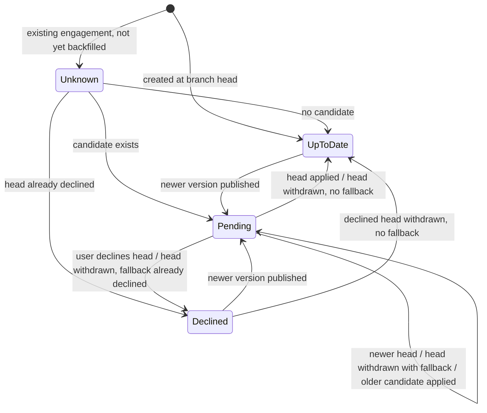
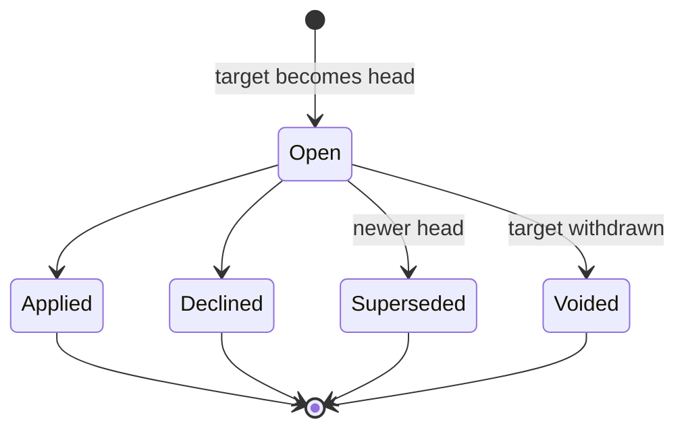

# 1.2 Version-Graph Semantics

**Status:** Closed. **Scope:** business semantics only, independent of implementation.

Template publication lifecycle and engagement update-decision lifecycle are modelled separately.

## Confirmed decisions

| Topic | Decision |
|---|---|
| Identity | A version is identified by `(templateId, versionId)`, references its parent, and the template DB keeps the full lineage. |
| Branching | A branch is a market line. Each branch is a single chain. There are no offers across branches. |
| Accumulation | Versions are cumulative along their own lineage only. A descendant includes its ancestors' changes; a version on another branch does not. |
| Decline | A decline keeps the engagement on its current version and is final for that target version, which can never be applied. Only a newer version on the same branch re-opens the offer. |
| Withdrawal | Irreversible. Users are not notified. The content team parents new versions on the last good version. |
| Event ordering | Template events carry a publish sequence. Engagement events carry a per-engagement sequence. Every decision names the target version it was made against. |
| Decision authority | A user decides manually, per engagement. There is no firm-level policy or bulk automatic decision. |
| New engagements | Created at the latest non-withdrawn version of their branch. |
| Backfill | Imports the current version and all past decisions. |
| Summary on re-offer | Plain diff from current version to head, with no marker for previously declined changes. |

## Definitions

| Term | Meaning |
|---|---|
| `cur(e)` | The engagement's actual version. It changes only through the engagement system's Created and Applied events and is never inferred. |
| `cand(e)` | Non-withdrawn versions with the same `branchId` as `cur(e)` and a higher `branchSeq`. |
| `head(e)` | The candidate with the highest `branchSeq`. |
| `declined(e)` | The targets the user declined while on `cur(e)`. |
| `status(e)` | **UP_TO_DATE** if there is no head. **DECLINED** if `head(e)` is in `declined(e)`. **PENDING** otherwise. **UNKNOWN** until the engagement has been projected. |

Confidence key: **C** = confirmed; **A** = assumption, with confidence level.

## A. Rules

| ID | Scenario | Trigger / Condition | Expected Behavior | State Transition | Confidence |
|---|---|---|---|---|---|
| R1 | Identity | Any version | Identified by `(templateId, versionId)`. Versions are immutable. `versionId` is never compared numerically. | — | C |
| R2 | Ordering | Comparing versions | Within a branch, order is `branchSeq`. A version descends from another when it is on the same branch with a higher `branchSeq`. | — | C |
| R3 | Cumulativity | Descendant published | Contains all changes of its ancestors and none from other branches. | — | C |
| R4 | Applicability | Version published | Offered only if non-withdrawn and in `cand(e)`. | — | C |
| R5 | Supersession | Newer candidate published before the user acts | `head(e)` moves forward. There is one open offer per engagement; the previous offer becomes Superseded. | PENDING → PENDING | C |
| R6 | Summary scope | Offer opened | Single plain diff `cur(e)` → `head(e)`. Never a chain of diffs and never specific to one engagement. | — | C |
| R7 | Apply | Engagement system reports apply | `cur(e)` becomes the applied version and status is recomputed. Applying an older candidate leaves the offer PENDING on the newer head. | PENDING → UP_TO_DATE or PENDING | C (apply mechanics out of scope) |
| R8 | Decline | User declines `head(e)` | Record `(e, target, basedOn = cur)`. `cur(e)` does not change. The declined target can never be applied; the engagement system enforces this. | PENDING → DECLINED | C |
| R9 | Re-offer | Newer candidate published after a decline | Offer re-opens. Its summary covers `cur(e)` → new head, including the changes declined earlier. | DECLINED → PENDING | C |
| R10 | Withdrawal | Version withdrawn | Irreversible. Never changes `cur(e)`. No notification. | Version Withdrawn (final) | C |
| R11 | Withdrawn head | `head(e)` withdrawn | Fall back to the next candidate. If that candidate was already declined, status is DECLINED with no action available. If none remains, UP_TO_DATE. | PENDING → PENDING, DECLINED or UP_TO_DATE | C |
| R12 | Withdrawn current version | `cur(e)` withdrawn | The engagement keeps that version and stays eligible for later versions on its branch. | No change | A, high |
| R13 | Descendants of a withdrawn version | Publish after a withdrawal | The content team parents the new version on the last good version. The system does not validate this. | — | C |
| R14 | New engagement | Engagement created | Created at the latest non-withdrawn version of its branch. | Created as UP_TO_DATE | C |
| R15 | Decision authority | — | A user decides manually, per engagement. | — | C |
| R16 | Derived status | Any event | Status is a pure function of `(graph, cur, declined)`. It is always recomputed, never adjusted step by step. | — | Design rule, high |
| R17 | Duplicates | Any event repeated | No effect. The graph only grows, the withdrawn flag can only be set, `cur` keeps the highest `engagementSeq`, and decisions are keyed by `(e, target)`. | No change | C |
| R18 | Out-of-order delivery | Late or reordered events | A withdrawal that arrives before its publish leaves a marker and the publish is ignored. A gap in `branchSeq` triggers a lineage fetch from the template DB. A late decision applies only to the target it names. An engagement event with a lower sequence is ignored. | Per R16 | A, high |
| R19 | Apply on a declined target | Applied event names a declined target | Record `cur(e)` as reported (the engagement system is authoritative) and raise an anomaly alert. | Recompute | A, high |
| R20 | Backfill | Existing engagement not yet projected | No flag is shown. The backfill imports `cur(e)` and past decisions, then evaluates. | UNKNOWN → evaluated | C. A: old decision records name the target version (60%). |

## B. Decision matrix

| # | Scenario | Before | Event | After | Notes |
|---|---|---|---|---|---|
| 1 | V1 → V2 | cur V1, UP_TO_DATE | Publish V2 | PENDING (V2) | Summary V1→V2 |
| 2 | V1 → V2 → V3 before user action | PENDING (V2) | Publish V3 | PENDING (V3) | V2 offer Superseded. Summary V1→V3. |
| 3 | V2 declined, then V3 | DECLINED (V2) | Publish V3 | PENDING (V3) | Summary V1→V3 includes V2's changes |
| 4 | V2 applied, then V3 | cur V2, UP_TO_DATE | Publish V3 | PENDING (V3) | Summary V2→V3 |
| 5 | V2 withdrawn while pending | PENDING (V2) | Withdraw V2 | UP_TO_DATE | V2 offer Voided |
| 5b | V3 withdrawn, V2 still a candidate | PENDING (V3) | Withdraw V3 | PENDING (V2) | New offer opened for V2 |
| 5c | V3 withdrawn after V2 was declined | PENDING (V3), V2 declined | Withdraw V3 | DECLINED (V2) | No apply possible |
| 6 | V2 withdrawn after being applied | cur V2 | Withdraw V2 | No change | Later versions on the branch remain offerable |
| 7 | V2 withdrawn after being declined | DECLINED (V2) | Withdraw V2 | UP_TO_DATE | Decision kept for audit |
| 8 | Parallel branches: CA V4→V5→V7, EU forks V4→V6 | CA engagement, cur V5 | Publish V6 (EU) | No change | Publishing V7 later gives PENDING (V7) |
| 9 | Duplicate publish | Any | Same event again | No change | R17 |
| 10 | Withdrawal arrives before publish | — | Withdraw V2, then publish V2 | Never flagged | R18 |
| 11 | Late decline | PENDING (V3) | Decline of V2 arrives | PENDING (V3) | Decline recorded but has no effect |
| 12 | Late apply | PENDING (V3) | Apply of V2 arrives | cur V2, PENDING (V3) | R7 |
| 13 | Stale engagement event | cur V2 (seq 9) | Event with seq 7 | Ignored | R18 |

## C. State machines

The engagement's actual version (`cur`) is a separate attribute. It changes only through the Created and Applied events from the engagement system.

**Engagement update status (derived):**

**Offer lifecycle (audit record, one per engagement and target):**

Offers in a final state are never modified. If the head falls back to an earlier version, a new offer is opened.

## D. Downstream implications

| WBS | Implication |
|---|---|
| 2.2 Projection model | Entities: `VersionNode(templateId, versionId, parentId, branchId, branchSeq, withdrawn)`; `EngagementProjection(engagementId, firmId, region, templateId, branchId, cur, curSeq, engagementSeq, status, head)`; `Offer` and `Decision` records that never change once written. Index on `(templateId, branchId, curSeq)`. |
| 2.3 Publish-to-flag hot path | Finding affected engagements is one indexed query with no graph walk and no engagement load: `templateId = T AND branchId = B AND curSeq < newSeq`. Withdrawals use the same query. |
| 3.1 Migration and backfill | Imports `cur(e)` and past decisions. Engagements show no flag until backfilled. **Risk:** old decision records may not name the target version (60%). Verify this first. |
| 3.2 Idempotency and reconciliation | State-based recomputation makes replays safe. Requires per-engagement sequence numbers and withdrawal markers. Reconciliation checks `cur` and decisions against the engagement system, plus the R19 anomaly. |
| 5.1 Summary generation | Global, immutable cache keyed by `(templateId, fromVersion, toVersion)`. The number of distinct pairs is bounded by the distinct current versions × heads per branch. Withdrawal never deletes a summary, because it is needed for audit. |
