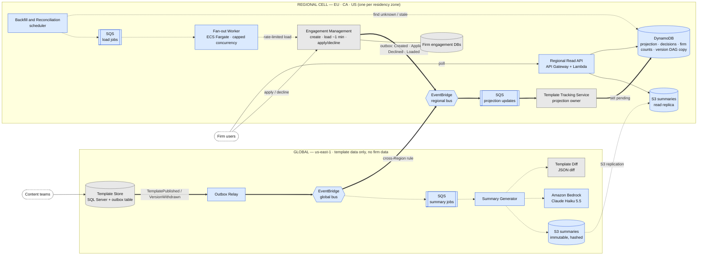

## 2.1 Architecture and Data Ownership

The design separates a **global template plane** (us-east-1, template content only) from **regional cells** (EU, CA, US). Each cell holds all engagement data and the derived state for its residency zone. Events flow one way only, from global to cell. No engagement data leaves its cell.

**Legend.**
- Edges: thick `==>` is the hot path, dotted `-.->` is the cold path, thin `-->` is the read/user path.
- Nodes: grey is an existing service, blue is a new component.

### Ownership

| Component | Owner | Scope | Data it owns |
|---|---|---|---|
| Template Store + outbox | Content platform (existing) | Global | Template versions, version DAG, publish/withdraw events |
| Summary Generator + S3 summaries | This feature | Global | One summary per version pair: immutable, hashed, with model and prompt versioned |
| Template Tracking Service | Existing service, extended | Per cell | Projection: engagement → template, version, branch; pending state; decisions; per-firm counts |
| Engagement Management | Existing team | Per cell | Engagement files; emits lifecycle and decision events through an outbox |
| Fan-out Worker, Reconciliation | This feature | Per cell | Load jobs only; no business state |

### Key decisions

| Decision | Rationale | Trade-off |
|---|---|---|
| The Template Tracking Service owns the projection. Engagement Management only emits events. | One clear owner and a minimal change to a live system. | Eventual consistency, so drift is possible. Reconciliation corrects it. |
| Pending state is materialized per engagement at publish time. | Full audit trail from the first moment; "at a glance" reads are cheap key lookups. | Write amplification: ~20k–200k projection writes per publish. |
| Global template plane, one-way event flow to cells. | Template content is not firm-specific, and engagement data stays in-region. | A us-east-1 outage delays new publishes. Cell reads are unaffected. |
| The version DAG travels in the event and is copied into each cell. | No synchronous cross-region call on the hot path. The 1.2 rules are evaluated locally. | Duplicated metadata. Version gaps are repaired by reconciliation against the Template Store. |
| A transactional outbox on the Template Store and Engagement Management. | Removes the dual-write problem between the DB commit and the event. | An extra relay component. At-least-once delivery means consumers must be idempotent (3.2). |
| Summaries are generated once per version pair, globally, and replicated read-only. | No firm data reaches the LLM, and cost does not depend on engagement count. | The summary may lag the flag by minutes. The UI shows "summary pending". |
| Users poll a regional read API. | Stateless, cheap, no connection management. | User-visible latency is propagation time plus the poll interval. |
| The ~1 min engagement load runs only on the cold path, through a capped worker. | Protects the other team's limited capacity. | Engagements not yet backfilled show "status unknown" until they are loaded. |

### Hot path vs. cold path

| | Hot path | Cold path |
|---|---|---|
| Purpose | Publish or withdraw → pending state queryable | Backfill, reconciliation, verification loads, LLM summaries |
| Latency target | Seconds (p95 SLO set in 4.2) | Minutes (summaries) to days (backfill) |
| Work per publish | ~20k projection writes on average*; ~5 s at 4,000 WRU/s (DynamoDB new on-demand warm throughput) | Rate-limited by downstream capacity: 20k loads at 50 concurrent ≈ 7 h |
| Uses the 1-min load? | **Never** | Yes, through the Fan-out Worker (Part 2) |

\* 800k engagements / 40 products, assuming an even spread (~60% confident; the per-product skew is unknown). A 200k-engagement product takes ~50 s unless the table is pre-warmed.

### Open risks and assumptions

- **Cross-Region EventBridge targets in CA and EU (~60% confident).** The launch supported only a few destination Regions; current docs refer to "supported destination Regions". Verify `ca-central-1` and the chosen EU Region before committing. Fallback: SNS in us-east-1 with cross-region SQS subscriptions.
- **Write bursts and hot partitions.** DynamoDB allows 1,000 WCU/s per partition, so the 40k-engagement firm must not be a partition key (2.2). Firm counts are aggregated once per batch rather than once per engagement.
- **"Within seconds" vs. polling.** A 30 s poll gives ~35 s end to end. This is the requirement challenged in Section 6.
- **Outbox in Engagement Management (assumption, unverified).** It must commit decision events atomically with the decision itself, even though engagements live in firm-specific databases.
- **Backfill coverage.** Until each existing engagement is loaded once, the UI shows "unknown", never "no updates" (3.1).

### References

- [EventBridge — sending events between Regions](https://docs.aws.amazon.com/eventbridge/latest/userguide/eb-cross-region.html)
- [EventBridge cross-Region targets — launch note (2021)](https://aws.amazon.com/about-aws/whats-new/2021/04/amazon-eventbridge-introduces-support-cross-region-event-bus-targets)
- [Transactional outbox pattern — AWS Prescriptive Guidance](https://docs.aws.amazon.com/prescriptive-guidance/latest/cloud-design-patterns/transactional-outbox.html)
- [DynamoDB on-demand capacity mode](https://docs.aws.amazon.com/amazondynamodb/latest/developerguide/on-demand-capacity-mode.html)
- [DynamoDB warm throughput scenarios](https://docs.aws.amazon.com/en_us/amazondynamodb/latest/developerguide/warm-throughput-scenarios.html)

*AWS limits above are as documented on 2026-11-09. The product skew, poll interval, concurrency cap and Engagement Management outbox are architectural assumptions.*
