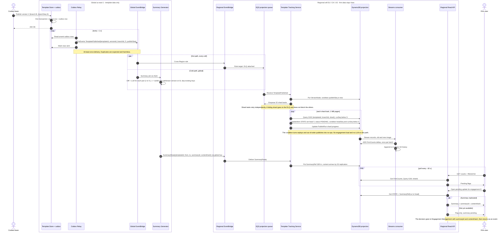

# 2.2 Data Model and Publish → Flag Sequence

**Status:** Closed · **Date:** 2026-11-09
**Builds on:** 1.2 (version-graph semantics, rules R1–R22) and 2.1 (ownership, global vs. regional, hot vs. cold path).

Confidence key: **C** = confirmed; **A** = assumption, with a confidence level.

## 1. Inputs carried forward

| Topic | Decision | Source |
|---|---|---|
| Source of truth | The Template Store (global) owns versions and lineage. Engagement Management owns `cur(e)` and decisions and is authoritative (R20). The Template Tracking Service owns the regional projection. | 1.2, 2.1 |
| Status | `status = f(graph, cur, declined)`. It is always recomputed, never adjusted step by step (R16). It is stored as a derived field. | 1.2 R16 |
| Eligibility timing | Computed at publish time, per engagement. | 2.1 |
| Decision scope | `(engagement, target, basedOn = cur)`. Final for that target. A newer version on the same branch re-opens the offer. | 1.2 R8, R9 |
| Ordering | Template events carry `publishSeq`. Engagement events carry `engagementSeq`. Every decision names its target. | 1.2 |
| Summary key | `(templateId, from, to)`. Global and immutable. | 1.2 R22, 2.1 |
| Notification | A persisted flag, read by periodic polling of a regional API. | 2.1 |
| UI | A filterable list per engagement for clients, plus a Caseware internal list. | 2.2 (C) |
| History | State lives on the projection item, plus an append-only change history. | 2.2 (C) |
| Summary link | The UI sends `summaryId` and `contentHash` with each decision. Engagement Management includes them in its event. | 2.2 (C) |
| Seeding | Engagement Management can list engagement IDs, with firm and region, without loading any engagement. | 2.2 (C) |
| Visibility | Counts are firm-wide. The existing authorization layer filters access per engagement. | 2.2 (C) |

## 2. Entities

One regional DynamoDB table per cell (single-table design), plus S3. Key prefixes such as `ENG#` and `FIRM#` mark the item type.

| Entity | Purpose | Key | Essential fields | Source of truth or derived | Owner · region |
|---|---|---|---|---|---|
| **VersionNode** | Version graph used to evaluate eligibility | Template Store: `(templateId, versionId)`. Cell copy: PK `TPL#templateId`, SK `VER#branchId#branchSeq` | `versionId`, `parentId`, `branchId`, `branchSeq`, `publishSeq`, `withdrawn` | Source of truth: the Template Store. The cell copy is derived from events. | Content platform · **global**, copied to each cell |
| **EngagementState** | The projection: one item per engagement | PK `ENG#engagementId`, SK `STATE` | `firmId`, `templateId`, `branchId`, `curVersionId`, `curSeq`, `declinedTargets` (a set, scoped to `cur`), `headVersionId`, `headSeq`, `status` (UNKNOWN / UP_TO_DATE / PENDING / DECLINED), `lastEngagementSeq`, `itemVersion`, display fields (name, client), `source` (EVENT / BACKFILL / RECON) | **Derived** from Engagement Management events and the version graph | Template Tracking Service · **regional** |
| **DecisionRecord** | Immutable audit record of each apply or decline | PK `ENG#engagementId`, SK `DEC#targetVersionId` | `decision`, `target`, `basedOn`, `userId`, `decidedAt`, `summaryId`, `contentHash`, `engagementSeq`, `bulkJobId` (optional, reserved) | A copy. Engagement Management stays authoritative. | Template Tracking Service · **regional** |
| **FirmCounts** | "At a glance" totals per firm and product | PK `FIRM#firmId`, SK `CNT#templateId` | Count per status, `asOf` | **Derived**, eventually consistent | Template Tracking Service · **regional** |
| **FirmMeta** | Number of GSI1 shards for each firm | PK `FIRM#firmId`, SK `META` | `shardCount`: 1 by default, 16 for firms with more than ~5k engagements (A, 70%) | Configuration | Template Tracking Service · **regional** |
| **PublishRun** | Progress of each publish, for the flag-latency SLO and for resuming work | PK `PUB#publishSeq`, SK `SHARD#n` | `status`, `matched`, `updated`, `startedAt`, `doneAt`, TTL of 30 days | Operational metadata | Template Tracking Service · **regional** |
| **SummaryRecord** | Immutable human-readable summary | S3 `summaries/{templateId}/{from}/{to}/{summaryId}.json`, with Object Lock. Cell pointer: PK `SUM#templateId#from#to`, SK `GEN#n` | `diffHash`, `modelId`, `modelVersion`, `promptVersion`, `contentHash`, `createdAt`, `evalStatus` | Source of truth: global S3. The cell holds a read replica and a pointer. | Summary Generator · **global**, no firm data |
| **EngagementHistory** | Change history of each engagement: versions, offers, supersessions, decisions | S3 `history/{firmId}/{yyyy-mm-dd}/…`, append-only | Old and new item image, event ID, sequence numbers, timestamp | **Derived** from DynamoDB Streams | Template Tracking Service · **regional** |

There is **no deduplication table and no Offer entity**. Idempotency comes from conditional writes (§4). Offer history comes from EngagementHistory, so it adds no writes to the hot path.

## 3. Indexes and access patterns

| Access pattern | Served by | Notes |
|---|---|---|
| Engagements affected by a publish or a withdrawal | **GSI2**: PK `templateId#branchId#shard` (32 shards), SK `curSeq`, **KEYS_ONLY** | Query `curSeq < S` on all shards in parallel. Flag writes don't touch GSI2, because `curSeq` changes only on create or apply (A, 90%). |
| Firm list with filters | **GSI1**: PK `firmId#shard`, SK `status#templateId#engagementId`, INCLUDE `cur`, `head` and display fields | Status and product are key filters (`begins_with`). Other filters use a FilterExpression, bounded to at most 40k items per firm. |
| Badge or detail for one engagement | GetItem `ENG#id / STATE`, plus `SUM#…` | One key lookup each |
| Firm counts | Query `FIRM#firmId`, prefix `CNT#` | At most 40 items |
| Caseware internal list | GSI2 inside each cell | **Residency:** engagement lists stay in their cell. A global view shows counts only. |
| Engagements still UNKNOWN (backfill and reconciliation) | GSI1 with prefix `UNKNOWN#` | Rows are seeded from Engagement Management's ID listing (3.1) |

**No scans of firm databases.** Engagement Management pushes events; nothing ever queries the firm databases. Engagements without a known version stay UNKNOWN until the throttled backfill reaches them (3.1).

**Large firms and hot partitions:**
- The base table is keyed by `engagementId`, so writes spread evenly.
- GSI1 is sharded per firm, and GSI2 is sharded 32 ways. Throttling on an index throttles writes to the base table (A, 90%), so sharding protects the hot path.
- The table is pre-warmed before large publishes (4.1).

## 4. Consistency and idempotency

| Operation | Write | Guard (condition) |
|---|---|---|
| Version published | Put VersionNode | `publishSeq` is new |
| Flag on publish | UpdateItem STATE: `head = V`, `status = PENDING` | `(attribute_not_exists(headSeq) OR headSeq < S) AND curSeq < S`. `curSeq` is re-checked on the base item because GSI2 can be stale. |
| Withdrawal | Read, recompute with R11, conditional put | `itemVersion` unchanged since the read |
| Created / Applied | Recompute STATE from the local version graph | `lastEngagementSeq < seq` |
| Decision | `TransactWriteItems`: Put DEC + Update STATE | DEC `attribute_not_exists`; STATE `lastEngagementSeq < seq` |

- **Atomic:** all state for one engagement lives on one item, and each decision is written in one transaction together with its state change.
- **Eventually consistent:** FirmCounts, GSI1 and GSI2, EngagementHistory, and the summary pointer. Reconciliation corrects any drift (3.2).
- **Replays and out-of-order publishes** fail their condition and are skipped as no-ops.
- **Writes per affected engagement on publish:** about 2–3 write units: the base item, plus a delete and an insert on GSI1 when the status changes (A, 80%). Volumes are in 4.1.

## 5. Publish → flag sequence

**Legend:** `->>` is a synchronous call; `-)` is asynchronous. Engagement loading and LLM inference never sit on the path that sets the flag.

## 6. Bulk decisions: suggested, not implemented in v1

| Option | Scope | Pros | Cons |
|---|---|---|---|
| 0. Not implemented (**v1**) | One decision per engagement | Simplest. Consistent with R15. | Tedious for very large firms. |
| 1. Same-pair bulk (**suggested increment**) | Same firm, same template, same `(cur → head)` pair, so the user has read one summary | One summary backs every decision, so the audit stays clean. No new index. | Engagements on different current versions form separate groups. A selection can go stale. |
| 2. Bulk by any criteria (rejected) | Any filter | Most flexible | Several summaries back one decision, giving a weak audit trail. Conflicts with R15. |

**How option 1 would work:**
- **Selection:** GSI1 with prefix `PENDING#templateId`, filtered on the projected `cur` and `head`. The key is not extended with these fields, because that would rewrite the index on every supersession.
- **Ownership:** Engagement Management owns the bulk job. The job expands into per-engagement decisions that share `summaryId` and `bulkJobId`.
- **Stale items:** an item whose head has moved since selection is skipped and reported to the user.
- **Capacity:** if a decision needs an engagement load (A, 50%), the job runs through the capped fan-out worker (Part 2), never on the hot path.

**Hooks kept in v1:** the optional `bulkJobId` on DecisionRecord, and a per-item guard (`target == current head`). The guard also protects single decisions from a stale head.

**Risk:** firms' quality reviewers may reject bulk decisions on audit engagements (A, 60%). This needs product and compliance validation.

## 7. Dependencies on other sections

| # | Item | Effect | Section |
|---|---|---|---|
| D1 | Bulk decisions | Option 1 only, deferred. Compatible with R15. | 6 |
| D2 | Summaries generated eagerly for all earlier versions on the branch | Keeps events flowing one way, global → cells. Cost grows with branch length, not with engagement count. A `cur` older than the retention window needs an on-demand request that carries version IDs only. | 4.1, 5.1 |
| D3 | An engagement created during a fan-out can be missed because of GSI lag | The Created handler recomputes from the local version graph. Reconciliation closes the remaining gap. | 3.2 |
| D4 | Display fields | Assumes `EngagementCreated` carries the name and client. They stay in the cell. (A, 70%) | 3.1 |
| D5 | Seeding UNKNOWN rows | Comes from Engagement Management's ID listing. Backfill resolves them. | 3.1 |
| D6 | Write volume per publish and pre-warming | About 2–3 write units per affected engagement | 4.1 |

## 8. References

- [DynamoDB transactions](https://docs.aws.amazon.com/amazondynamodb/latest/developerguide/transaction-apis.html)
- [Condition expressions](https://docs.aws.amazon.com/amazondynamodb/latest/developerguide/Expressions.ConditionExpressions.html)
- [Global secondary indexes](https://docs.aws.amazon.com/amazondynamodb/latest/developerguide/GSI.html)
- [Write sharding](https://docs.aws.amazon.com/amazondynamodb/latest/developerguide/bp-partition-key-sharding.html)
- [DynamoDB Streams](https://docs.aws.amazon.com/amazondynamodb/latest/developerguide/Streams.html)
- [Warm throughput](https://docs.aws.amazon.com/en_us/amazondynamodb/latest/developerguide/warm-throughput-scenarios.html)
- [Transactional outbox pattern](https://docs.aws.amazon.com/prescriptive-guidance/latest/cloud-design-patterns/transactional-outbox.html)
