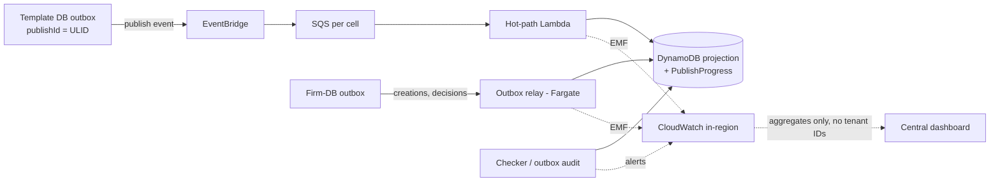

# 4. Scale, Cost and Operations

> Full arithmetic, pricing basis and sensitivity tables are in `wbs-4.1-scale-cost-arithmetic.md`. This section closes WBS 4 with the 4.1 headline figures and the 4.2 SLO and observability design. All targets are **proposed**, not Caseware commitments.

## 4.1 Scale and cost: headline figures

| | Low | Mid | High |
|---|---|---|---|
| All-in per month (AWS + inference + reconciliation loads) | ~$255 | ~$735 | ~$1,475 |
| One-time backfill (loader team) | ~$1.1k | ~$1.5k | ~$1.8k |
| Peak burst: engagements flagged by one publish | 10k | 88k | 338k |
| Time to flag a burst at default DynamoDB warm throughput (4,000 WRU/s) | 3 s | 33 s | 152 s |
| Warm throughput needed for a 15 s flag | none | ~9k WRU/s | ~41k WRU/s |
| Backfill elapsed time (US cell, the bottleneck) | 5 d | 19 d | 76 d |

**Bottlenecks to defend**

1. **Hot path:** DynamoDB warm throughput in the largest cell, not compute. Fix it with a one-time pre-warm of the table and GSI1.
2. **User-visible latency equals the poll interval.** The backend flags in seconds; a 30 s poll gives p95 ≈ 35 s (feeds the Section 6 challenge).
3. **Cold path:** backfill cost is fixed by load-minutes, but elapsed time depends entirely on the loader team's capacity.
4. **Cost driver:** polling and the outbox relay are ~75% of Mid. Inference is under 2%.

## 4.2 SLOs and observability

**Measurement principle.** Publishes are rare (~173/month) and bursty: one publish can produce up to 338k flag writes. A per-engagement, time-window error budget would be spent by a single bad publish. Completeness is therefore measured **per publish per cell**, and latency per engagement. Each SLO separates the backend (what we control) from user-visible latency (set by the poll interval).

### SLO table

| Area | SLI | Proposed SLO | Measurement | Alert / action |
|---|---|---|---|---|
| **Backend flag freshness** (user-facing) | `flaggedAt − publishCommittedAt` per eligible engagement | p95 ≤ 15 s, p99 ≤ 60 s over 28 days. Requires the 4.1 pre-warm (Mid ~9k, High ~41k WRU/s, US cell). | The hot-path Lambda stamps both times on the flag write and emits an EMF histogram with dimension `cell`. | Page if p99 > 60 s on 2 consecutive publishes |
| **User-visible freshness** (derived) | Publish → flag shown in the UI | p95 ≤ 45 s with a 30 s poll | Backend latency + poll interval. Optional client RUM (New Relic Browser) if Product needs proof. | Dashboard only |
| **Flag completeness** (user-facing) | `flagged / expected` per (publishId, cell); *expected* = eligible engagements in the projection at publish time | ≥ 99% of publishes 100% flagged within 5 min; 100% within 1 h via sweeper. Budget ≈ 2 late publishes/month. | `PublishProgress` row (expected / done / failed); checker Lambda every minute | Page if incomplete at T+5 min |
| **Event integrity** (internal) | (a) Template-outbox publishes with no `PublishProgress` in a cell; (b) firm-DB outbox relay lag (creations, decisions → projection) | (a) 0 undetected, detected ≤ 5 min; (b) relay lag p99 ≤ 60 s | (a) Audit Lambda diffs the outbox log against consumed `publishId`s; (b) relay emits `RelayLagSec` | Page on (a); page on (b) if > 5 min |
| **Projection correctness** (internal) | Mismatch rate in reconciliation sample (0.5% / 2% / 5%); backfill coverage % per cell | Mismatch ≤ 0.1% of sampled loads per month; coverage on track with the 4.1 plan (≥ 90% of planned daily rate) | Reconciliation worker compares loaded state with the projection; worker emits `BackfillCoverage` | Ticket (P2): repair rows, fix root cause |
| **Downstream protection** (internal) | Loader in-flight vs. budget; 429/5xx rate | In-flight ≤ budget **always**; error rate < 1%; throughput ≥ 90% of allocated slots during backfill | Worker gauges `LoaderInFlight`, `LoaderBudget`; outcome counters | Ticket + automatic AIMD back-off. A budget breach stops the worker. |
| **LLM summaries** (user-facing, degraded) | Time from publish to summary available per version pair; success after retries | 99% within 15 min; ≥ 99.5% success | Summary service emits latency, outcome, judge pass rate (Mid/High) | Ticket only. UI shows the flag with "summary pending". |

Confidence: p95 ≤ 15 s backend is **~75%** with pre-warm and GSI1 sharding, and should be confirmed by a load test at the High burst. Without pre-warm, Mid and High cannot meet it (33 s / 152 s).

### Essential metrics

**AWS-provided** (infrastructure health; none of these proves business correctness):

| Service | Metrics |
|---|---|
| SQS | `ApproximateAgeOfOldestMessage`, `ApproximateNumberOfMessagesVisible` on main queues **and DLQs**. DLQ depth is read from `…Visible`, because messages moved by a redrive policy do not increment the DLQ's `NumberOfMessagesSent` (~85% confident). |
| DynamoDB | `WriteThrottleEvents` (table and GSI1), `ThrottledRequests`, `SuccessfulRequestLatency`, `ConsumedWriteCapacityUnits` |
| Lambda | `Errors`, `Throttles`, `ConcurrentExecutions`, `Duration` (hot path, checker, read API) |
| API Gateway (read API) | `5xx`, `Latency`, `Count` |
| EventBridge | `FailedInvocations`, `InvocationsSentToDlq` |
| ECS on Fargate (relay, worker) | Container Insights: task restarts, CPU, memory |

**Custom business metrics** (CloudWatch embedded metric format):

| Metric | Emitter |
|---|---|
| `FlagLatencyMs` | Hot-path Lambda |
| `PublishExpected`, `PublishFlagged`, `PublishFailed`, `PublishCompletionSec` | Hot-path Lambda / checker |
| `MissingPublishCount` | Outbox audit Lambda |
| `RelayLagSec`, `RelayErrors` | Outbox relay (Fargate) |
| `ReconSampled`, `ReconMismatch` (by mismatch class) | Reconciliation worker |
| `LoaderInFlight`, `LoaderBudget`, `LoaderOutcome`, `BackfillCoverage` | Fan-out worker (Part 2) |
| `SummaryLatencySec`, `SummaryOutcome`, `SummaryEvalPass` | Summary service |

**Cardinality rule.** Allowed dimensions: `cell` (3), `outcome`, and `firmSizeBucket` (S < 100, M < 1k, L < 10k, XL ≥ 10k). The bucket exposes tenant skew without per-tenant series. `firmId` and `engagementId` appear only in in-region logs, never as metric dimensions.

### Alerts

| # | Alert | Threshold | Severity | Response |
|---|---|---|---|---|
| 1 | Publish incomplete | `flagged < expected` at T+5 min in any cell | Page | Check DLQ and DynamoDB throttles; redrive; sweeper re-runs idempotent upserts. |
| 2 | Missing or delayed events | Outbox publish with no `PublishProgress` after 2 min, or relay lag > 5 min | Page | Re-emit from the outbox (idempotent); check the EventBridge rule or relay task. |
| 3 | Hot-path stall | Oldest message > 2 min or DLQ depth > 0 on hot-path queues, or sustained `WriteThrottleEvents` during a publish | Page | Inspect the poison message; raise warm throughput if throttled; redrive after the fix. |
| 4 | Downstream saturation | Loader 429/5xx > 5% for 15 min, or `LoaderInFlight > LoaderBudget` | Ticket | Automatic back-off; notify the loader team. A budget breach is a bug: stop the worker. |
| 5 | Projection drift | Mismatch > 0.1% per month, or a repeating mismatch class | Ticket (P2) | Classify, repair rows, close the event gap. |

Deliberately **not** alerted: single retries, transient throttles that self-heal, read-API p99 blips, and summary delays under 30 min.

### Observability flow

- **Correlation:** `publishId` is minted in the template outbox and carried in every event, SQS message attribute, log line and `PublishProgress` row. Firm-side events carry their own `eventId`. Downstream records add `cell` and `engagementId`.
- **Logs:** structured JSON in CloudWatch Logs **in the cell's region**, 30-day retention. IDs and versions only, never engagement content. Audit records (decisions, summaries, 10-year immutable retention) are not logs and are stored separately (Section 5).
- **Tracing (optional):** X-Ray or AWS Distro for OpenTelemetry at ~5% sampling, propagated through the SQS `AWSTraceHeader` attribute. It helps diagnose latency; it **cannot prove completeness**. Only expected/done counts can.
- **Central view:** cross-region CloudWatch dashboards receive tenant-free aggregates only. About 75% confident this satisfies the residency contracts; legal must confirm.
- **Cost:** ~20 custom metrics × 3 cells ≈ 60 series ≈ $18/month at $0.30/metric (~85% confident on the price). Log ingestion is the real driver, so the hot path logs per batch, not per engagement. Both fit inside the 4.1 observability allowance ($50 / $100 / $200).

### Blind spots

1. **Completeness is relative to the projection.** An engagement missing from the projection never "fails" on the hot path. Reconciliation and backfill coverage are the only guards.
2. **Engagements not yet backfilled** show "status unknown", never "up to date". `BackfillCoverage` tracks this per cell.
3. **Aggregates hide small firms.** Per-publish exact counts, the size-bucket dimension and in-region Logs Insights drill-down by `firmId` mitigate this.
4. **Infrastructure green ≠ business correct.** All-green AWS metrics can coexist with a missing publish; alert 2 exists for exactly this.

### Design review questions

**Q1. Your expected count comes from the same projection you write to. Isn't completeness circular?**
At the first layer, yes, which is why there are two. Layer 1 (per publish, minutes) checks flags against the projection. Layer 2 (days) checks the projection against authoritative engagements through reconciliation sampling and creation/archival event counts. Together they bound the error; neither alone does.

**Q2. How do you detect an event that never arrived, rather than one that failed?**
Failures leave traces (DLQ, errors); missing events leave nothing. The outbox is the source of truth, and an audit diffs it against consumed IDs every minute, turning absence into a countable metric.

**Q3. Product asked for "within seconds". Your user-visible p95 is 45 s. Did you miss the requirement?**
The backend meets seconds (p95 ≤ 15 s, given pre-warm). The remaining delay is the poll interval, a deliberate cost and simplicity trade-off (4.1: push would cost ~$26/month plus messages). If Product needs seconds end to end, push is a contained change at the read edge. This is the requirement challenged in Section 6.

## Hand-off

| To | Item |
|---|---|
| 5 (Summaries) | Summary SLO: 99% within 15 min; judge pass rate as quality SLI |
| 6 (Tradeoffs) | "Within seconds" holds for the backend; user-visible latency is set by polling |
| Part 2 (worker) | Worker must emit `LoaderInFlight`, `LoaderBudget`, `LoaderOutcome`, `BackfillCoverage`, and never exceed the budget |
| Before submission | Load-test the High burst with pre-warm; confirm residency stance on aggregate metrics; verify the pre-warm charge |

## References

- [Amazon CloudWatch](https://docs.aws.amazon.com/AmazonCloudWatch/latest/monitoring/WhatIsCloudWatch.html)
- [CloudWatch embedded metric format](https://docs.aws.amazon.com/AmazonCloudWatch/latest/monitoring/CloudWatch_Embedded_Metric_Format.html)
- [Amazon SQS CloudWatch metrics](https://docs.aws.amazon.com/AWSSimpleQueueService/latest/SQSDeveloperGuide/sqs-available-cloudwatch-metrics.html)
- [DynamoDB metrics and dimensions](https://docs.aws.amazon.com/amazondynamodb/latest/developerguide/metrics-dimensions.html)
- [DynamoDB warm throughput](https://docs.aws.amazon.com/amazondynamodb/latest/developerguide/warm-throughput.html)
- [AWS X-Ray](https://docs.aws.amazon.com/xray/latest/devguide/aws-xray.html)
- [AWS Distro for OpenTelemetry](https://aws-otel.github.io/)
