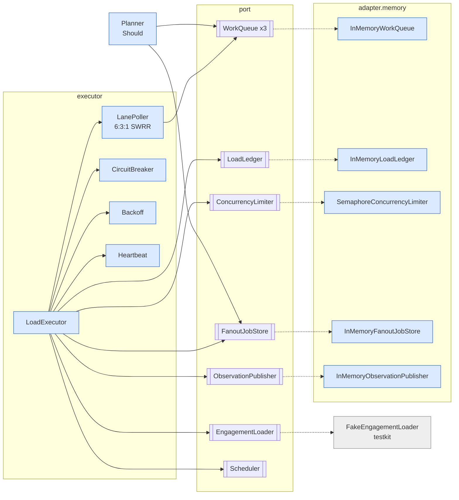
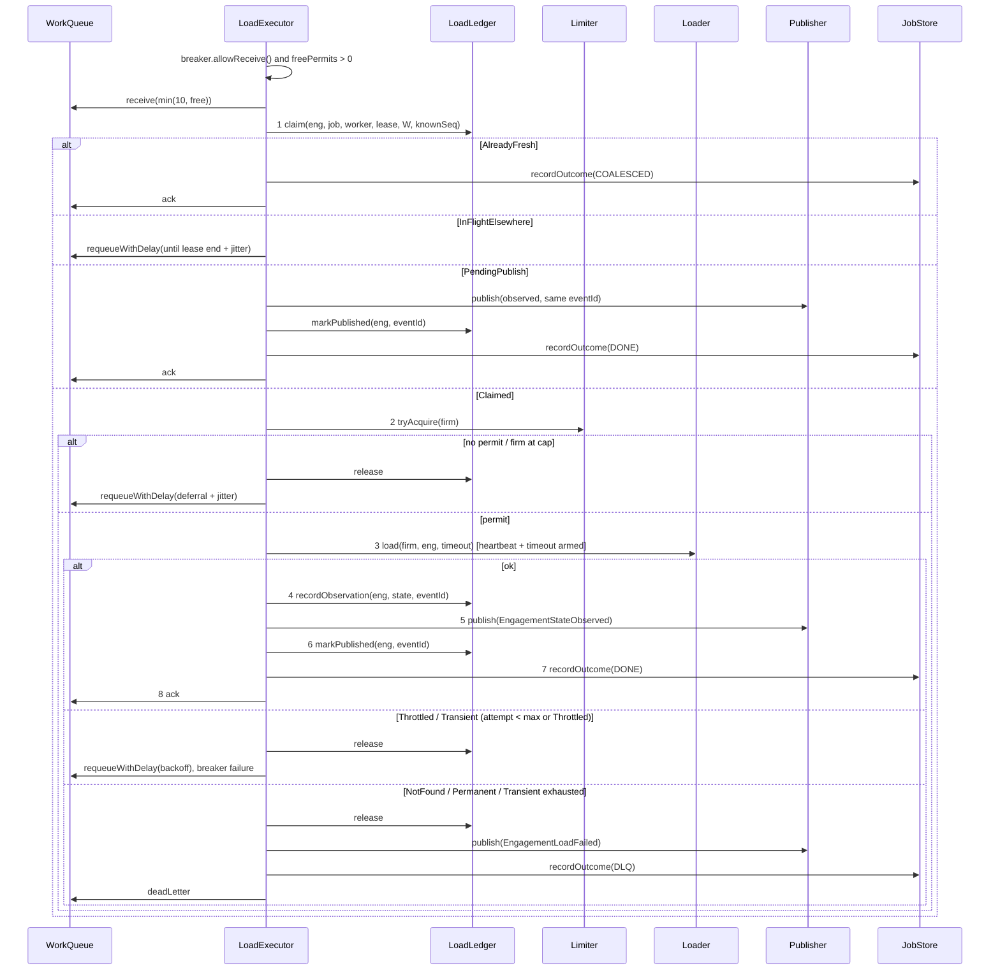

# Fan-out Worker (Part 2): Design

> Prompt A, Phase 4. Implements contract §B–§D with the approved gaps in [`contract-gaps.md`](contract-gaps.md). Tags as in `requirements.md`.

## 1. Components and packages



```
com.caseware.fanout
  domain          records, enums, sealed types (§B + G-04, G-06, G-07, G-08, G-16, G-26)
  port            WorkQueue, Delivery, LoadLedger, Claim, ConcurrencyLimiter, Permit, FanoutJobStore,
                  EngagementLoader, ObservationPublisher, CandidateSource, Scheduler
  executor        LoadExecutor, LanePoller, LaneQueues, CircuitBreaker, Backoff, Heartbeat, ExecutorConfig, ExecutorFactory
  planner         Planner (story 14)
  adapter.memory  InMemoryWorkQueue, InMemoryLoadLedger, SemaphoreConcurrencyLimiter,
                  InMemoryFanoutJobStore, InMemoryObservationPublisher, VirtualThreadScheduler
test: testkit (MutableClock, ManualScheduler, FakeEngagementLoader, CrashInjector, Await,
               ExecutorHarness, FakeTrackingServiceConsumer), contract (ContractE01…E10), mirrors of main
```

## 2. Responsibilities

| Class | One reason to change |
|---|---|
| `LoadExecutor` | The 8-step order and the branch per `Claim` and per `LoaderException`. Owns `workerId`. `pollOnce()` for deterministic tests; `start()/stop()` loop on a virtual thread. |
| `LanePoller` | Which lane(s) to receive from next (G-13). Strategy. |
| `LaneQueues` | Composite `WorkQueue` over the three lanes: receive via `LanePoller`, other operations to the request's own lane. |
| `CircuitBreaker` | CLOSED/OPEN/HALF_OPEN transitions on the clock (G-03). State pattern via a sealed state type. |
| `Backoff` | Delay for a retry or deferral: full jitter, `retryAfter` floor, 15-min cap (G-12, G-16, G-24). Strategy. |
| `Heartbeat` | Schedules `extendVisibility` every interval; cancelled in `finally` (§C). |
| `ExecutorConfig` | Every duration and number; `production()` and `forTests()`; validates G-14, G-15. |
| `ExecutorFactory` | Wires N executors with shared adapters and per-task limiter and breaker (G-15). |
| `InMemory*` adapters | Mimic SQS/DynamoDB semantics atomically (§5). |

## 3. Executor sequence



Permit is closed right after step 3 returns; heartbeat and timeout are cancelled in `finally`. An unexpected `RuntimeException` anywhere releases permit and claim and leaves the message un-acked (G-23). A publish failure leaves it un-acked; the redelivery takes the `PendingPublish` branch (G-22). For the DLQ branch the order is publish → outcome → dead-letter (dead-letter acts as the ack), so a crash in between costs at most one reload and a duplicate no-op outcome, never a lost event or outcome.

## 4. Concurrency model

- **Threads.** Each executor runs one receive loop on a virtual thread; each received message is handled on its own virtual thread. Concurrency is bounded by permits, not by threads.
- **Permits.** Per task: `⌊C/N⌋` via a `Semaphore` (`tryAcquire`, never blocking) plus a per-firm `ConcurrentHashMap<firmId, AtomicInteger>` capped at `k = max(1, ⌊0.2·⌊C/N⌋⌋)`. Acquire order: firm slot, then semaphore; roll back the firm slot on semaphore failure. Global invariant: Σ tasks ≤ N·⌊C/N⌋ ≤ C.
- **Receive sizing.** At most `freePermits` messages per receive (G-24), so deferrals happen mostly for the firm cap.
- **Lanes.** SWRR cycle of 10 slots (6:3:1 → P B P P B P R P B P), one slot per receive; empty lane → the next lanes in cycle order (G-13). `LaneQueues` presents the three lanes to the executor as one `WorkQueue` and routes ack/extend/requeue/dead-letter by `LoadRequest.lane`.
- **Breaker.** Per task (G-27). OPEN → loop skips receive and idles via the scheduler; in-flight loads finish (A7). HALF_OPEN → receive exactly one message as the probe.
- **Coalescing.** Atomic ledger claim (G-19) guarantees one `Claimed` per engagement per lease; duplicates requeue until the lease ends (G-05) and then coalesce.

## 5. Time model

- All time is `clock.instant()` from an injected `Clock`; jitter from an injected seeded `Random`.
- **Lazy expiry (G-10):** visibility, message delay, lease, freshness W and breaker cool-down are evaluated when read. No background threads in adapters.
- **Scheduler port:** heartbeat (`scheduleAtFixedRate`) and hard timeout (`schedule`). `VirtualThreadScheduler` in production; `ManualScheduler.runDue()` in tests, firing tasks whose due time ≤ `MutableClock` now.
- **Two test modes:**
  - *Deterministic* (E2 detail, E3, E6, E7, breaker, queue/ledger units): `MutableClock` + `ManualScheduler` + `pollOnce()`; the fake loader blocks on latches the test releases.
  - *Concurrency* (E1, E4, E5, concurrency units): system clock + `VirtualThreadScheduler` + `ExecutorConfig.forTests()` with ms-scaled durations; assertions on counts and ranks, never on wall-clock time (G-09).

## 6. In-memory adapter semantics (mirroring AWS)

| Aspect | SQS / DynamoDB | In-memory |
|---|---|---|
| Visibility | Invisible until timeout; then redelivered | `invisibleUntil` per message; receivable when `≤ now` |
| Receive count | +1 per receive | +1 per receive; on the receive that would exceed `maxReceiveCount` (5) → lane DLQ |
| Receipt | New receipt per receive; old receipt invalid | UUID per receive; stale receipt ack/extend = no-op |
| `extendVisibility` | `ChangeMessageVisibility` | `invisibleUntil = now + by` |
| `requeueWithDelay` | Send new + delete old | New message (fresh ID, count 0, `visibleAt = now + min(delay, 15 min)`), old removed atomically |
| Ordering | Best-effort; fair queues per `MessageGroupId` | FIFO by `visibleAt` then enqueue order; fairness comes from the firm cap (E5) |
| Ledger / job store | Conditional writes, transactions | `ConcurrentHashMap.compute` per key; job item + counter updated in one `compute` |
| Publisher | EventBridge `PutEvents` | Appends to a list; scripted failures |

Thread-safety: queue uses one `ReentrantLock` per lane (receive must scan and mark atomically); ledger and job store rely on per-key `compute`.

## 7. Crash simulation

`CrashInjector` points: `AFTER_CLAIM`, `AFTER_LOAD`, `AFTER_RECORD`, `AFTER_PUBLISH`. The executor calls `crashHook.at(point)` at each; armed, it throws `SimulatedCrash extends Error`, which the handler does not catch (G-11). The test discards that executor, advances `MutableClock` past lease and visibility, and runs a fresh executor with a new `workerId`. Expected: `AFTER_CLAIM`/`AFTER_LOAD` → one reload; `AFTER_RECORD` → `PendingPublish`, no reload; `AFTER_PUBLISH` → `PendingPublish` path republishes the same `eventId` (ledger not yet `DONE`), counters unchanged by the duplicate.

## 8. Key tradeoffs

| Decision | Rejected alternative | Why / cost |
|---|---|---|
| Requeue `InFlightElsewhere` until lease end (G-05) | Ack and attach job to owner | No lost item on owner crash; costs one extra message per duplicate and up to one lease of latency. |
| `release` on deferral (G-21) | Swap claim and permit | Keeps the load-bearing order and doesn't spend permits on duplicates; one extra ledger write per deferral. |
| Lazy expiry + `Scheduler` only for heartbeat/timeout (G-10) | Global tick loop | Less machinery; adapters stay passive and deterministic under `MutableClock`. |
| Scheduler-driven hard timeout with interrupt (G-28) | `Future.get(timeout)` | Testable under the manual clock; permit held until the call truly returns, so the capacity invariant stays exact. |
| Bounded `Transient` retries (G-16) | Unbounded retries | Stops a permanently slow engagement from looping; `Throttled` stays unbounded so E4 holds. Costs one field on `LoadRequest`. |
| Rank-based fairness assertion (G-09) | Wall-clock bound | Deterministic; still proves the cap's effect (1,350 vs ≈ 40,000). |
| Per-task breaker (G-27) | Shared breaker | No shared state; matches static permit split. |
