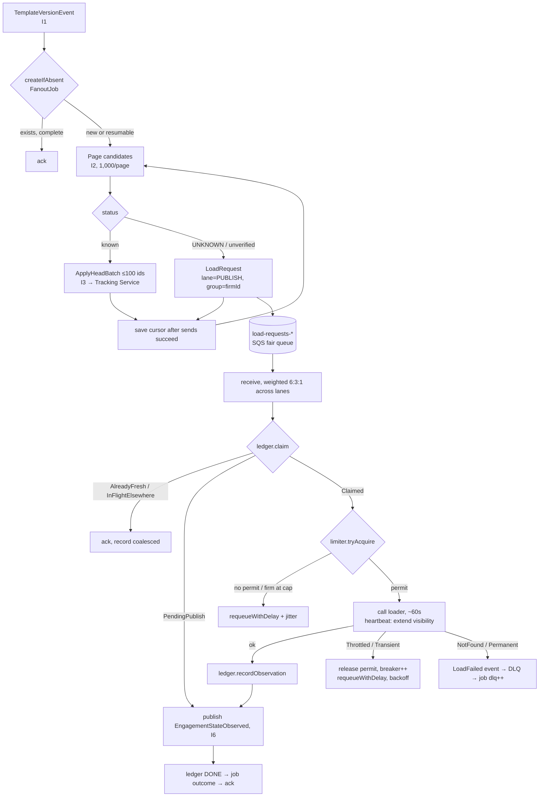

# Step 7: Part 2 Design: Fan-Out Worker Contract Spec

> Caseware take-home, WBS 7. Contracts and behavior only; no implementation code.
> Builds on WBS 1.2 (version-graph rules), 2.1 (ownership), 2.2 (projection), 3.2 (idempotency/outbox), 3.3 (failure recovery/residency).

## 0. Scope and assumptions

The fan-out worker runs **in each regional cell** and has two roles:

- **Planner (Stage A):** turns one publish or withdraw event into flag commands and load work. It reads the projection but never writes it.
- **Load Executor (Stage B):** calls the ~1-min engagement loader under a capacity budget and reports observations. **This is the Part 2 code.**

| # | Assumption | Confidence | If wrong |
|---|---|---|---|
| A1 | The loader returns `engagementSeq` (the engagement outbox sequence at read time). | **60%. Validate with the owning team.** | Observations may only fill `UNKNOWN` fields and never overwrite event-sourced state. Weaker, but still safe. |
| A2 | Every catalogued engagement has a projection row (seeded in 3.1); `templateId` may be null. | 75% | Null-template rows go to the backfill lane, not to publish jobs. |
| A3 | Loader capacity is a **per-region** cap `C` (50 / 200 per 3.3 scenarios). Saturation is signalled by 429 or timeout. | Assumption | A global cap needs a cross-region quota service. |
| A4 | Fixed task count `N` per cell (no autoscaling). Each task holds `C/N` permits. | Design choice | See §F. |
| A5 | Part 2 runs with in-memory adapters behind ports. No AWS SDK, no Docker. LocalStack + Docker Compose is an optional extra. | Decision | — |

**Changes to earlier steps:**

- **3.2:** the work-ledger key changes from `(engagementId, targetVersion)` to `engagementId` + `observedSeq`, to coalesce loads.
- **3.3:** `FanoutJob` gets separate flag and load counters. The publish→flag SLO is measured on Stage A only.

## A. Interface contract

| # | Interface | Direction | Owner | Payload | Semantics / guarantee |
|---|---|---|---|---|---|
| I1 | `template-events` SQS (fed by the regional bus) | In → Planner | Content platform | `TemplateVersionEvent` | At-least-once, unordered. Order comes from `branchSeq` / `graphRev`. |
| I2 | `CandidateSource` (query API) | Planner → Tracking Service | Tracking Service | `templateId`, `branchId`, cursor, limit | Paged, read-only, eventually consistent (GSI lag; gap closed per 2.2 D3). |
| I3 | `tracking-commands` SQS | Planner → Tracking Service | Tracking Service | `ApplyHeadBatch` (≤100 ids) | At-least-once. Tracking Service applies with conditional writes. |
| I4 | `load-requests-{publish,backfill,reconcile}` SQS standard, `MessageGroupId = firmId` | Planner / backfill / reconciliation → Executor | This feature | `LoadRequest` | At-least-once. Fair queues across firms. One DLQ per lane. |
| I5 | `EngagementLoader` (sync) | Executor → Engagement Mgmt | Other team | `firmId`, `engagementId` | Read-only, ~60 s, capacity-bound, **no idempotency key**. |
| I6 | `engagement-observations` (regional bus) | Executor → Tracking Service | This feature (schema) | `EngagementStateObserved` / `EngagementLoadFailed` | At-least-once. Deterministic `eventId` lets the consumer dedupe. |
| I7 | `LoadLedger`, `FanoutJob` (DynamoDB, regional) | Executor / Planner internal | This feature | see §B | Conditional writes. The ledger doubles as the observation outbox. |

**Envelope rules (all messages):**

- Every message carries `schemaVersion`, `correlationId` (= the originating publish `eventId`) and `region`.
- Payloads carry IDs and versions only, never workpaper content.
- Schema changes are additive only, and consumers use a tolerant reader (per 3.2).

## B. Contracts (Java 21, signatures only)

```java
// ---- Inbound (I1) ----
record TemplateVersionEvent(String eventId, int schemaVersion, Kind kind,      // PUBLISHED | WITHDRAWN
    String productId, String templateId, String branchId, String versionId,
    long branchSeq, long graphRev, Instant occurredAt) {}
// jobId is deterministic: productId:branchId:versionId:graphRev   (3.2 key)

// ---- Planner I/O (I2, I3) ----
interface CandidateSource {
  Page<Candidate> find(String templateId, String branchId, Cursor cursor, int limit);
}
record Candidate(String firmId, String engagementId, ProjectionStatus status, long knownSeq) {}
record ApplyHeadBatch(String jobId, String templateId, String branchId, long graphRev,
    List<String> engagementIds, String correlationId) {}

// ---- Work item (I4) ----
record LoadRequest(String requestId, String jobId, String firmId, String engagementId,
    String templateId, Lane lane, long knownSeq, Instant enqueuedAt, String correlationId) {}
enum Lane { PUBLISH, BACKFILL, RECONCILE }

// ---- Downstream port (I5) ----
interface EngagementLoader {
  EngagementTemplateState load(String firmId, String engagementId, Duration timeout)
      throws LoaderException;
}
record EngagementTemplateState(String engagementId, String templateId, String branchId,
    String curVersionId, List<DecisionRef> decisions, long engagementSeq, Instant observedAt) {}
sealed class LoaderException extends Exception
    permits Throttled, Transient, NotFound, Permanent {}   // Throttled carries retryAfter

// ---- Outbound (I6) ----
// eventId = engagementId + ":" + engagementSeq   (deterministic dedupe key)
record EngagementStateObserved(String eventId, int schemaVersion, String region, String firmId,
    EngagementTemplateState state, List<String> jobIds, String correlationId) {}
record EngagementLoadFailed(String eventId, String firmId, String engagementId,
    FailureReason reason, String jobId, String correlationId) {}

// ---- Infrastructure ports (in-memory adapters for Part 2) ----
interface WorkQueue<T> {
  List<Delivery<T>> receive(int max, Duration wait);
  void extendVisibility(Delivery<T> d, Duration by);
  void ack(Delivery<T> d);
  void requeueWithDelay(Delivery<T> d, Duration delay);  // new message: receive count resets
  void deadLetter(Delivery<T> d, String reason);
}
record Delivery<T>(T body, String receipt, int receiveCount) {}

interface LoadLedger {                      // key: engagementId
  Claim claim(String engagementId, String jobId, String workerId,
              Duration lease, Duration freshness, long knownSeq);
  void recordObservation(String engagementId, EngagementTemplateState s);  // -> PENDING_PUBLISH
  void markPublished(String engagementId, long observedSeq);              // -> DONE
}
sealed interface Claim permits Claimed, AlreadyFresh, InFlightElsewhere, PendingPublish {}

interface ConcurrencyLimiter {              // C/N permits per task + per-firm in-flight cap
  Optional<Permit> tryAcquire(String firmId);
}

interface FanoutJobStore {                  // per-item conditional transition + counters
  boolean createIfAbsent(FanoutJob job);
  void recordOutcome(String jobId, String engagementId, Outcome o);
}
```

**`FanoutJob` record (I7):**
- `jobId`, `status` (`PLANNING | PLANNED | SUPERSEDED | COMPLETE`), `plannerLease`, `cursor`, `graphRev`.
- Stage A counter: `flagBatchesSent`.
- Stage B counters: `loadsExpected`, `loadsDone`, `loadsDlq`.
- The load side closes when `loadsDone + loadsDlq = loadsExpected`.

## C. Processing flow



### Processing semantics

**Planner**
- Only one planner runs per job, enforced by a conditional `plannerLease` on `FanoutJob`.
- The cursor is saved only after a page's sends succeed. It is an efficiency aid, not a correctness requirement.
- Before each page, the planner checks the cell's latest `graphRev` for the branch. If a newer job exists, it stops and marks the job `SUPERSEDED`. Queued loads stay valid, because observations are version-agnostic.

**Executor step order (load-bearing)**
1. Claim the ledger entry.
2. Acquire a permit.
3. Call the loader.
4. `recordObservation` (ledger becomes the outbox).
5. Publish the observation.
6. `markPublished`.
7. Record the job outcome.
8. Ack the message.

**Visibility heartbeat**
- Initial visibility is 3 min, extended by 3 min every 60 s while the load runs.
- The loader has a hard 5-min timeout; when it fires, the call is treated as `Transient`.
- SQS limits visibility to 12 h. Extensions do not persist: the next receive reverts to the queue default.

**Receive count is reserved for real failures**
- Throttling and fairness deferrals use `requeueWithDelay`: send a new message, then delete the old one.
- They do not use a visibility change. Otherwise a long loader outage would push healthy messages to the DLQ after `maxReceiveCount = 5`.

**Circuit breaker**
- When the breaker is open, the executor **stops receiving**. It does not receive and then defer.

**Lanes and fairness**
- Lanes are polled with 6:3:1 weights (publish : backfill : reconcile).
- SQS fair queues deprioritize noisy firms, but they don't cap per-tenant consumption. The executor therefore also enforces a per-firm in-flight cap: `max(1, 0.2 × C/N)` per task.

## D. Correctness and failure matrix

| Scenario | Expected behavior | Mechanism |
|---|---|---|
| Duplicate publish event | One job | Deterministic `jobId` + `createIfAbsent` |
| Planner crashes mid-page | Resumes; some items re-sent | Stored cursor; downstream is idempotent |
| Two planners on the same job | One proceeds | Conditional `plannerLease` |
| Duplicate `LoadRequest`, or v6 and v7 both queue the same engagement | **One load** within freshness window W | Ledger claim on `engagementId`; `AlreadyFresh` → ack |
| Executor crashes during the load | ≤1 extra load (~1 min), no loss | Lease expires and the message reappears |
| Crash after the load, before publish | **No reload**; result republished | Ledger `PENDING_PUBLISH` acts as the outbox |
| Publish succeeds, crash before ack | Duplicate event, harmless | `eventId = engagementId:seq`; Tracking Service seq guard |
| User declines while the load is in flight | The decline wins | Higher `engagementSeq` on the decline event (A1) |
| Version withdrawn during the job | New job at a higher `graphRev`; old planner stops | `graphRev` check per page; Tracking Service recomputes head |
| Load shows a different template or branch | Observation still published; Tracking Service recomputes (no longer a candidate) | Observation is a fact, not a command |
| Loader returns 429 or saturates | Throughput drops; nothing goes to the DLQ | Permit released, requeue with backoff, breaker |
| Loader down for hours | Backlog grows; flags for known rows unaffected | Breaker stops receiving; reconciliation re-enqueues past SQS retention (max 14 days, ~90% confidence) |
| Engagement not found or archived | Fails immediately | `LoadFailed` + DLQ; job `dlq++`; Tracking Service marks the row |
| Poison message (schema) | DLQ, alarm | Tolerant reader; `schemaVersion` |
| A 40k-engagement firm floods the queue | Small firms keep low wait times | Fair queues (`MessageGroupId = firmId`) + per-firm cap |
| Duplicate job outcomes | Counters stay exact | Per-item conditional transition + counter in one transaction |

**Guaranteed**
- No lost work: every item ends `DONE` or in the DLQ, or reconciliation re-enqueues it.
- Concurrent loader calls never exceed `C`.
- A stale observation never overwrites newer state.

**Eventual / best-effort**
- Load latency, bounded by backlog ÷ C.
- At most one extra load per crash.

## E. Testing contract (priority order)

All tests use in-memory adapters, a deterministic `Clock`, and a fake loader with controllable latency and failures.

1. **Capacity invariant.** With N workers, 10k requests and C permits, peak concurrent loader calls stay ≤ C, and peak per firm stays ≤ the firm cap.
2. **Coalescing.** Duplicate and cross-version requests for one engagement cause exactly **one** loader call within W.
3. **Crash injection** after claim, after load, after `recordObservation`, and after publish. The system converges with ≤1 extra load and no lost item.
4. **Throttling doesn't dead-letter.** A sustained 429 period sends zero messages to the DLQ, and every item completes once throttling stops.
5. **Fairness.** One 40k firm plus 100 firms of 40 each: every small firm's first load starts within a bounded wait.
6. **Permanent error.** The item goes to the DLQ immediately, emits `LoadFailed`, and the job closes when `done + dlq = expected`.
7. **Heartbeat.** A load running 3× the visibility timeout is never processed twice.
8. **Job idempotency.** Duplicate events and duplicate outcomes leave the counters exact.
9. **Supersession.** A withdraw at a higher `graphRev` stops the old planner and keeps its loads.
10. **Consumer-driven contract with the Tracking Service.** A lower-seq observation is ignored, and a duplicate `eventId` is a no-op.

## F. Decisions and tradeoffs

| Decision | Rejected alternative | Why / cost |
|---|---|---|
| **ECS/Fargate service**, Java 21 virtual threads behind a semaphore | Lambda | A hard concurrency cap that holds across retries is awkward, and timeout headroom is thin for 1-min calls plus retries. |
| | Step Functions Distributed Map | Per-transition cost and complexity for little benefit (~75% confident on cost). |
| **Static permit split** (C/N per task, fixed N ≥ 2) | DynamoDB lease-based global limiter | Simplest. If one task dies, capacity drops to (N−1)/N until restart. The lease limiter is the upgrade path. |
| **SQS standard + fair queues**, 3 lane queues | FIFO; per-firm queues | FIFO adds nothing, since the version guard handles ordering. ~4,000 per-firm queues is an ops burden. |
| **Ledger keyed by engagement, doubling as outbox** | Key per `(engagement, version)` (old 3.2) | Saves loads during publish bursts and avoids reloads after a crash. Costs 1 extra write per load, negligible next to a 1-min call. |
| **Requeue-with-delay for deferrals** | Visibility-based deferral | Keeps `maxReceiveCount` meaningful. Costs 1 extra send per deferral. |
| **Planner sends commands; Tracking Service writes the projection** | Worker writes flags directly | Clean ownership (2.1). About 200 messages per 20k-candidate publish, which is trivial. |
| **In-memory adapters for Part 2** | LocalStack + Docker Compose | Fastest and deterministic. LocalStack is optional and validates wiring, not correctness. |

### Arithmetic

| C (per region) | Loads/hour | 40k-engagement firm | Full 800k backfill |
|---|---|---|---|
| 50 | 3,000 | ~13.3 h | ~267 h (~11 days) |
| 200 | 12,000 | ~3.3 h | ~67 h (~2.8 days) |

Stage A (flags for known rows) does not depend on `C`. Stage B is tracked by **backlog drain ETA** = backlog ÷ C minutes.

### Observability (in-region only; aggregates cross regions)

- Permits in use vs. `C`.
- Loader p50/p99 latency and 429 rate.
- Breaker state.
- Coalesce ratio.
- Queue age per lane, plus SQS `ApproximateNumberOfMessagesVisibleInQuietGroups`.
- DLQ depth (alarm on > 0).
- Job `expected / done / dlq`.
- Per-firm wait time (p95).

### Open uncertainties

| Item | Confidence | Action |
|---|---|---|
| A1: loader returns `engagementSeq` | 60% | **Riskiest assumption.** Validate with the Engagement Mgmt team. |
| Freshness window W (proposed 24 h) | Assumption | Agree with product. |
| Real value of `C` | Unknown | Agree with the owning team. |
| Fair-queue pricing (small surcharge per million requests) | ~70%, unverified | Check the SQS pricing page. |
| SQS max retention 14 days, max `DelaySeconds` 15 min | ~90% | Spot-check the docs. |

## References

- [Amazon SQS fair queues (Developer Guide)](https://docs.aws.amazon.com/AWSSimpleQueueService/latest/SQSDeveloperGuide/sqs-fair-queues.html)
- [Building resilient multi-tenant systems with Amazon SQS fair queues (AWS Compute Blog)](https://aws.amazon.com/blogs/compute/building-resilient-multi-tenant-systems-with-amazon-sqs-fair-queues)
- [ChangeMessageVisibility (SQS API Reference)](https://docs.aws.amazon.com/AWSSimpleQueueService/latest/APIReference/API_ChangeMessageVisibility.html)

## AI usage notes (Step 7)

- **AI helped:** structuring clarifying questions, enumerating failure modes, and spotting that throttling deferrals would consume `maxReceiveCount`.
- **Human decisions:** worker scope (Q1), read-only loader (Q2), event-based ownership (Q3), coalescing (Q4), lanes and fairness (Q5), in-memory adapters (Q6), split counters (Q7).
- **Do not trust AI here without verification:** AWS limits and pricing, the loader's actual contract (A1), and any claim about Caseware's existing systems.
